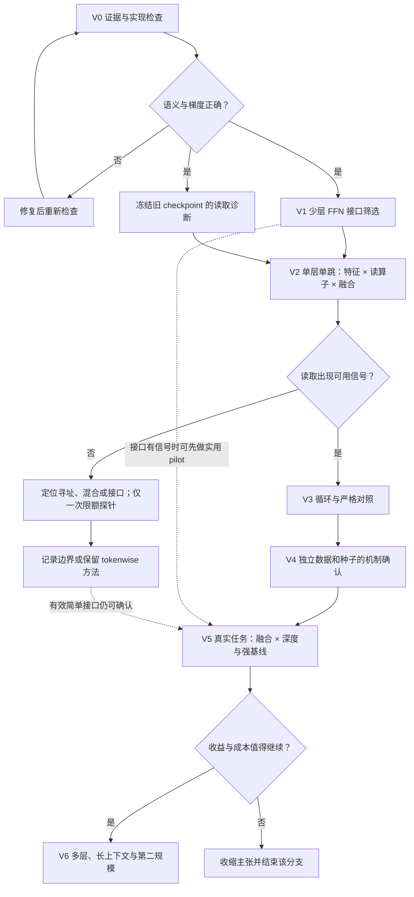
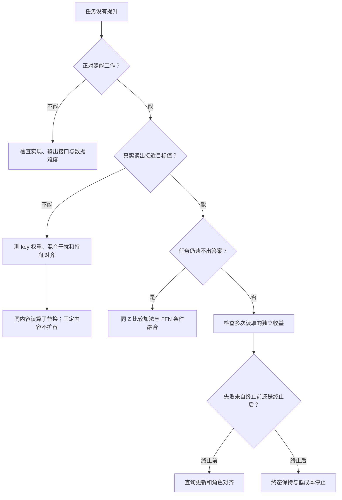

# 低维循环注意力与 FFN 条件融合：基于 LoopLora 实验证据的研究计划 v2

**主骨干：Qwen/Qwen3-0.6B-Base**  
**版本：2.0｜日期：2026-10-29（Asia/Tokyo）**  
**证据快照：UnbearableFate/LoopLora @ `a255e814740ff85ab3b4ec4836c88f0a8f802b2d`**  
**状态：已完成代码、报告与既有诊断的审查；本文新增实验尚未执行。**

> 本版取代 v1 的执行顺序、默认布局与实验预算，保留“冻结原 Transformer、低维侧分支、固定记忆内循环、原 FFN 的 gate/up 条件融合”这一研究对象。主要改变是：先分解信息读取和融合接口，再解释循环；将机制实验与保留原上下文的实用适配分开；把已有失败结果转化为可以定位原因的检查，而不是重复扩容。

## 阅读导航与证据说明

- 第 0–2 节：本次改动、历史结果及其适用边界。
- 第 3–5 节：统一数学定义、关键恒等式、探索分支图。
- 第 6–11 节：V0–V5 的具体运行矩阵与进入下一阶段的条件。
- 第 12–16 节：条件扩展、数据与统计、预算、参数、实现与交付要求。
- 第 17 节：第一批工作与结果到研究主张的对应关系。
- 第 18 节：固定版本证据和原始参考资料。

本文使用 **“已观察”** 表示仓库报告中的结果，**“推导”** 表示可由给定公式得到的关系，**“提议”** 表示尚未执行的新实验。报告中的旧研究名称 P1L、SQ2、LSQT 等保持原义；本版阶段统一使用 V0–V6，避免与旧研究或 SLOT-LOOP-v1 的 S0–S3 混淆。

用户提供的共享页 `https://chatgpt.com/s/t_6ae3091abbf481919d134f042045d961` 本轮未能直接取得正文。已读取此前的《LoopLoRA：实验诊断与下一阶段执行计划》全文 [D00]，并用仓库原报告核对其主要判断。该诊断提出的显式槽位方案仍是**待验证建议**，不能记作已完成实验。本文未访问 HPC 上的训练权重，未重新执行模型评估，也未向仓库提交修改。

---

## 0. 最重要的更新

### 0.1 核心判断

现有结果支持继续研究低维循环，但研究重心应从“组合更多组件”转为：

1. **低维分支实际读到了什么？** 分开检查特征、寻址、读取混合、下游解码。
2. **同一份低维信息应如何进入原 FFN？** 保留 concat 的独立研究价值。
3. **改变查询的重复读取是否提供独立收益？** 排除幅度、更多参数、更多训练和额外监督的解释。
4. **这些收益是否在原 attention 保留上下文时仍有价值？** 单独验证真实适配效果与成本。

旧 LoopLora **已经**让原线性层只执行一次、在侧面进行低维固定记忆循环。当前方案的新变化主要是 Q/K/V 特征来源、正核归一化读取、累加式循环、FFN gate/up 扩展和多层布局，而不是首次引入低维循环。[E13][E14]

### 0.2 v1 → v2 的修改清单

| v1 的安排或容易产生的理解 | v2 的安排 | 依据与目的 |
| --- | --- | --- |
| 默认直接使用 14 层、r=32 | 接口筛选先 4 层、r=32；机制桥接先单层、r=128；14 层后置 | 减少同时改变层数、宽度、读算子与融合方式的混杂 |
| 单轮记忆之后很快扩大循环 | 增加读取可用性检查、读算子诊断，再比较循环 | learned writer 的主要瓶颈尚未解决 |
| 把显式 KV 槽位视为当然更少损失 | 同核槽位是恒等对照；softmax 槽位是不同读算子 | 正核外积状态对同核加权读取是精确充分统计量 |
| 仅按 S=1/2/4 比较 | 加入固定查询、固定总步长、锚定更新、宽度和 readout 对照 | 旧循环与当前累加循环不是同一动力学 |
| 共享对随机初始化的非共享 | 增加同函数初始化或复制后解除共享 | B8W 说明非共享参数化可以保留已学会的解 |
| 合成任务主要负责低成本排名 | 原简单 full-context 题只作正确性参考；另选有区分度切片 | 旧保留上下文对照接近天花板 |
| 三方法确认容易混合 concat 与循环 | 实用确认保留 Fusion × Depth 四格，再加 LoRA、参数匹配加法与同参tokenwise组 | 独立估计接口、循环及侧支历史贡献 |
| 主要按总 tokens 对比 | 同时报主干 tokens、监督 tokens、queries、写读次数与 node·h | 旧 memory-only 训练预算口径不同 |
| 扩宽、换大模型、增加辅助 loss 可作普遍补救 | 这些改动只由具体诊断触发 | DPFP-X、SQ2、LSQT 已提供有限或负面结果 |

**建议首先执行 V0 + V1，训练上限 18M 个非 padding 输入 tokens，按样本呈现次数累计。** 这不是必须花完的配额；没有信号时收敛研究范围。缓存特征复用时，另报实际主干计算量。完整条件路线的训练规划上限仍为 480M，详见第 14 节。

---

## 1. 已有实验究竟说明了什么

### 1.1 证据账本

下表的 pp 表示百分点。不同任务、信息访问协议、数据区间或训练预算的数值不能串成同一条性能曲线。

| 研究与条件 | 已观察结果 | 对本计划的提示 | 不能推出的结论 |
| --- | --- | --- | --- |
| P1-L：0.6B、单层 14 的 o_proj、oracle memory、r128、3 seeds | hops 2–3：共享四读 M1 为 26.91%，单读 B4 为 5.36%；差 +21.55 pp，97.5% CI [20.38,22.76] | 保留“查询随循环变化”的主假设 | 新 QKV + concat、learned writer 或真实任务已经有效 |
| P5L：1.7B、同类 oracle 条件、3 seeds | 31.96% 对 6.17%；+25.78 pp，97.5% CI [24.53,27.03] | 有第二模型规模的同协议支持 | 放大 backbone 能解决写入与读取问题 |
| P1-L：r32 | hop1：B4/B8/M1 约 0.07/0.07/0.15%，无记忆 B3 为 0.03%；记忆使用 gate 失败 | 先校准接口可学性，不能在地板上解释循环差异 | r32 理论上不能工作，或多层 r32 也必然失败 |
| B8W：复制成功的 shared 解后解除共享，继续 2,000 步 | untied 32.40%，shared 31.50%；差 +0.90 pp，95% CI [0.09,1.71]；97.5% CI [-0.04,1.81]；通过非劣检查 | 比较共享时控制初始函数与续训预算 | 非共享已被证明更优，或共享是表达能力必要条件 |
| RFX：旧 R-r128，冻结 checkpoint 的析因诊断 | 原读取33.8%；校准scalar gain后：ridge/raw/fit 38.8%、delta/true/fit 39.9%、ridge/true/fit 84.2%；clean value84.4% | 旧条件存在存储与 query 的联合瓶颈；替换条件还需控制输出尺度 | 只改 query 或只改融合就足够；oracle 干预可部署 |
| DPFP：单 seed、T1、E16 | D128-3 为 60.8%；E8 另行重训 73.0%；均未过 80% 门槛 | 特征几何与负载值得诊断 | E8 是同一个 E16 模型的直接泛化结果 |
| DPFP-X：单 seed、同类 learned-writer 任务 | r256 为 66.2%；1.7B/r128 为 59.3%；均未通过旧 gate | 无诊断扩容优先级下降 | 更长训练无效；两条曲线末段仍在上升 |
| SQ2：同父 checkpoint，6,000 步继续训练，单 seed | delta 65.4%；delta+coef 63.0%；ridge 72.3%；ridge+coef 69.5% | 首先做读算子与训练收益的分解；辅助 loss 需要直接证据 | 组合方案通过了原注册规则，或所有辅助监督都无用 |
| LSQT：线性特征下从头训练 LSQ | 最佳 ridge 46.1%，读误差 0.512；处于原注册中间区间 | 不能把“从头 ridge”当未经试验的通用解决方案 | 整条 LSQ 路线已被理论否定；后续 U 对照已有结果 |
| P1L-C：读取位置与中间状态干预 | M1 只保留最后问题位置读取，hops1–3 约 33.64%→3.74%；z1 bridge patch shift +0.39 pp，95% CI [-0.13,0.78] | 控制所有读位置；可解码状态不等于因果桥 | 早位置读取是泄漏；每次循环已对应一跳 |
| CTC：学习解析器 + 固定 oracle code，单 seed | hop1 50.7%；hops2–3 多读差 +24.05 pp；候选被标记 | 可作为输入表示到 reader 的正对照 | 连续 learned key/value writer 已成功；开放词表泛化已验证 |
| LSR：oracle reader 的停止规则 | R2 改善长跳，但 0.6B hop2 下降 10.83 pp；平均读 5.60 次，需 6.60 次上层前向 | 停止方案必须同时报告短跳损失与完整计算路径 | 动态停止免费或已带来端到端加速 |

证据：[E01]–[E12]。P1-L 与 P5L 的区间条件于已训练的三个 seeds、指定 oracle 编码与布局，不覆盖所有 writer 初始化和新数据机制。SQ2、DPFP、DPFP-X、LSQT 的主要结果是一个训练 seed 上的验证筛选结果。

### 1.2 两个必须保留的细节

**SQ2 不能与历史父模型作不受控归因。** 同一组 D128-3 权重，零步换成 ridge 时已从 60.8% 到 68.7%；继续训练后到 72.3%。与此同时，delta 对照继续训练后也到 65.4%。因此，新算子的比较必须同时记录 step-0 与训练后差异。SQ2 原主对比是 ridge+coef 对 delta：+4.1 pp、读误差比 0.554，未达到其 +10 pp 与误差减半要求。ridge-only 是该表中的最佳单元，不会改写原 verdict。[E06]

**B8W 的主要结论是保留解。** 不同置信水平的区间不矛盾；本计划不把 95% 下的名义正差改写成注册的优越性结论。shared 继续训练本身也增加约 5.09 pp，说明“多训练”是需要匹配的因素。[E03]

### 1.3 不再作为默认失败解释的事项

仓库当前实现已关闭训练期 dropout 随机性，适配参数和 memory 使用 FP32，并有零出口初始化后的两步梯度启动、冻结主干输入 Jacobian 与数值一致性检查。此前确实修复过跨进程 GPU kernel history 导致的 BF16 support-state 不一致，但不能将其继续当作所有负结果的已确认原因。[E13]–[E17][E21][E22]

SQ2 中 clip=1 在所有**记录到的步**上生效，是事实；它是否抑制了辅助损失，需要逐项梯度证据。不能据此声称 AdamW 的有效学习率严格缩小为原来的十分之一。[E06]

---

## 2. 旧方法与当前方法的迁移边界

### 2.1 旧 LoopLora 的实际结构

用列向量表达旧方法，省略若干 feature-map 分支：

$$
u=Ax,\qquad z^{(0)}=u,
$$

$$
z^{(s+1)}=u+\rho\,\sigma\left(Rz^{(s)}+UM\psi(Qz^{(s)})\right),
\qquad y=Wx+\alpha Bz^{(S)}.
$$

默认旧写入使用 decay-first delta rule：

$$
\bar M=\lambda M,\qquad
M^+=\bar M+\beta(v-\bar M k)k^\top.
$$

一次问题读取的内循环中 M 固定。原 `base(x)` 只执行一次，主实验插在单个 `o_proj`。后续 DPFP、ridge 与 sweep 是明确不同的分支。[E13][E14][E18]

### 2.2 六个不能同时改变后再作单一归因的轴

| 轴 | 旧主要条件 | 当前候选 |
| --- | --- | --- |
| 输入 | o_proj 前的 attention 输出，另有 residual 变体 | 原 Q/K/V 的指定阶段，或 Norm 后隐藏态 |
| 写读 | delta / DPFP / ridge | 正核外积 + 分母归一化，或 softmax 槽位 |
| 循环 | 每轮重新锚定初始 u | 累加式 z 更新；另保留同核锚定对照 |
| readout | 完整 zS，含初始状态通路 | 循环增量 zS−z0；完整状态单独消融 |
| 融合 | o_proj 输出加法，经过原 residual/Norm/FFN | FFN 的 gate/up 条件项 |
| 布局与协议 | 单层；memory-only 为主要机制条件 | 少层/多层；context-retained 为实用条件 |

**同一个 r 不代表相近预算。** 旧单层 r32 的 stored adapter 约 103,426 参数；原 v1 的 14 层 r32 C_dual 为 4,616,192，约 44.6 倍。旧 r128 的 B4/M1 stored adapter 均 475,138，而该 reader 阶段可训练参数均为 442,368。必须区分存储参数与实际训练参数。[E01][E13]

### 2.3 信息访问协议分开登记

**M 线：memory-only 机制线。** 支持文本先产生可写特征；问答阶段丢弃支持文本的原主干 KV cache，仅保留声明的低维 memory。问题与答案不写入该 memory。每个问题从同一支持状态独立开始。

**F 线：context-retained 适配线。** 原 attention 按正常因果方式看到完整前缀；侧分支额外保留自己的状态。这里的任务增益可能来自融合、额外非线性、当前 token 通路或历史记忆，需要逐项诊断。

M 线的高分与 F 线的高分不是同一个指标。F 线没有显著侧支历史贡献时，仍可得到有用的 FFN 适配器，但不能称为“侧支记忆带来的收益”。旧单层 support 截断计算优化也不能直接用于新多层前向。[E15]

---

## 3. 当前核心方法的统一数学定义

以下全部采用**行向量**；t 是 token 位置，s 是同一个 token 内的循环步，ℓ 是原 Transformer 层。循环深度记 S，训练优化步数记 N_step，避免与旧报告的训练步数 S 混淆。

### 3.1 Qwen3-0.6B-Base 的固定结构

| 项目 | 官方值 |
| --- | ---: |
| 隐藏宽度 D / FFN 宽度 m / 层数 | 1024 / 3072 / 28 |
| Q heads / KV heads / head_dim | 16 / 8 / 128 |
| Q 投影总宽度 / K、V 总宽度 | 2048 / 1024、1024 |
| FFN / Q、K 归一化 | SwiGLU / 每头 QKNorm |
| 最大位置数 / RoPE theta | 32768 / 1000000 |
| attention bias / dropout | false / 0 |

来源：[R01][R02]。运行时锁定实际模型与 tokenizer revision；不得用非 Base 配置替代。由结构计算的唯一参数约 596,049,920，仍需实际加载后核对 tied embeddings，不能把计算值称为本轮测量。

### 3.2 原 Transformer 块

$$
N=\operatorname{Norm}_1(X),\quad
H=X+\operatorname{Attn}(N),\quad U=\operatorname{Norm}_2(H),
$$

$$
F(U)=\left[\operatorname{SiLU}(UW_g)\odot UW_u\right]W_d,
\qquad Y_{\rm base}=H+F(U).
$$

其中 Wg、Wu 为 D×m，Wd 为 m×D。原 attention 每层每次前向执行一次；循环只在新增低维分支中执行。

### 3.3 低维投影与用户提出的 activation 分支

主候选读取原 Q/K 在 **QKNorm 后、RoPE 前**的特征 Qb、Kb，Vb 为原 v_proj 输出；K/V 在 GQA repeat_kv 之前压缩：

$$
\bar Q=Q_bA_q,\quad \bar K=K_bA_k,\quad \bar V=V_bA_v.
$$

默认三路输出宽度均为 r：

$$
A_q\in\mathbb R^{2048\times r},\qquad
A_k,A_v\in\mathbb R^{1024\times r}.
$$

保留以下明确命名的特征变体，不能在实现中混用：

- `direct_hidden`：从 N 分别线性投影 Q/K/V，参数为 3Dr。
- `raw_qkv`：使用原投影、QKNorm 前的 NWq、NWk、NWv，再乘 A。
- `qknorm_pre_rope`：主候选。
- `activation_raw`：例如 SiLU(NWk)Ak，Q/V 同理；激活函数及位置必须写入配置。

线性重排 NWkAk=N(WkAk) 只对纯线性路径成立。引入 QKNorm 或 activation 后不能再这样合并。即使 activation(NWk) 非负，乘一个有正负系数的 Ak 后也可能为负；正核读取仍需显式定义最终的正特征映射。

### 3.4 归一化正核状态

低维归一化采用不带可训练仿射项的 RMSNorm：

$$\mathcal N_r(z)=\frac{z}{\sqrt{\frac1r\sum_j z_j^2+\epsilon_N}},\qquad\epsilon_N=10^{-6}.$$

正特征映射为：

$$
\phi(a)=\operatorname{ELU}(a)+1,
\quad k_t=\phi(\mathcal N_r(\bar k_t)),\quad v_t=\bar v_t.
$$

对允许写入的位置集合 \(\mathcal I_t\)，定义：

$$
M_t=\sum_{i\in\mathcal I_t}k_i^\top v_i\in\mathbb R^{r\times r},
\qquad c_t=\sum_{i\in\mathcal I_t}k_i^\top\in\mathbb R^{r\times1}.
$$

F 线的 inclusive 模式中，当前有效 token 先写一次，再读 \(i\le t\)；strict 模式改为 \(i<t\)，作为自作用诊断。M 线中 \(\mathcal I\) 是支持文本已完成的写入集合，问题阶段不再写。M 线首轮的写位置与读位置按第 8.1 节锁定，实际状态容量按写入项数计算，不能一律用事实数 E 替代。

同一 t 的各 s 步共享同一 M、c；不能每轮重复写当前 token。训练不允许让所有 t 共用全序列的 KᵀV，否则会泄漏未来信息。[R03]

### 3.5 最小累加循环

$$
z_t^{(0)}=\bar q_t,
\qquad \hat q_t^{(s)}=\phi\left(\mathcal N_r(z_t^{(s)})R_q\right),
$$

$$
a_{t,\rm raw}^{(s)}=\frac{\hat q_t^{(s)}M_t}{\hat q_t^{(s)}c_t+\epsilon},
\quad a_t^{(s)}=g\,a_{t,\rm raw}^{(s)},
\qquad z_t^{(s+1)}=z_t^{(s)}+\eta a_t^{(s)}R_o.
$$

Rq、Ro 都为 r×r，循环内共享，各原模型层暂不共享。首轮固定 eta=0.25、全局读增益g=1，二者不可训练；读取分母 epsilon=1e-6。两类backend都先产生a_raw，再统一乘g。后续改变步长或增益须登记为独立变体。主 readout：

$$Z_t=z_t^{(S)}-z_t^{(0)}.$$

这里的 Z 是**循环增量**，不是 delta-rule 写入。完整 state readout Z=zS 另设实验，因为它包含初始 query 的直接通路。

空记忆显式输出零；M、c 用 FP32 累积。若分母太小、状态溢出或存在无效写入，先修复实现，不以改变任务 gate 掩盖问题。

### 3.6 Concat 到原 FFN

保留原残差与 Norm，拼接的是 \([U,Z]\)，其作用可以不实际分配 concat 张量而等价实现为：

$$
Y=H+
\left[\operatorname{SiLU}(UW_g+ZC_g)
\odot(UW_u+ZC_u)\right]W_d,
$$

$$C_g,C_u\in\mathbb R^{r\times m}.$$

输入宽度 D→D+r，FFN 中间宽度 m 与输出 D 保持原值。原 Wg/Wu/Wd 冻结，Cg/Cu 零初始化，分支内部非零初始化，因此开始时与 Base 相同。首步只有出口获得梯度是预期；出口更新后，分支内部应获得梯度。

直接把 FFN 输入改成未加原残差的 `origin-attn(X)` 会改变预训练块语义。本计划以原 H/U 为锚点，落实用户的拼接想法。

---

## 4. 本次必须增加的数学检查与机制解释

### 4.1 最关键恒等式：同核槽位与矩阵状态完全等价

固定相同 key、value、query、mask 与 epsilon：

$$
\underbrace{\frac{q(\sum_i k_i^\top v_i)}{q(\sum_i k_i^\top)+\epsilon}}_{\text{KernelMatrix}}
=\underbrace{\sum_i\frac{qk_i^\top}{\sum_jqk_j^\top+\epsilon}v_i}_{\text{KernelSlot}}.
$$

**推导结论：** 对这个读取族，保存 M、c 没有引入额外近似；它是精确的聚合表示。整体槽位信息当然比单一矩阵多，但同核 read 无法使用那些额外信息。两种实现的输出及对应输入/参数梯度应在数值容差内相等。

因此，KernelSlot 只用于正确性与数值检查，不值得当成独立科学 arm 大规模训练。

### 4.2 SoftmaxSlot 真正改变了什么

另一种读算子是：

$$
w_i^{\rm soft}(q)=\frac{\exp(qk_i^\top/(s_0\tau))}{\sum_j\exp(qk_j^\top/(s_0\tau))},
\quad a_{\rm soft,raw}(q)=\sum_iw_i^{\rm soft}(q)v_i,
\quad a_{\rm soft}(q)=g\,a_{\rm soft,raw}(q).
$$

新分支固定s0=sqrt(dk)、tau=1、g=1；旧S-RE冻结诊断使用其原DPFP分数尺度，s0=1，单独校准，不复用温度值。SoftmaxSlot改变了权重分布、选择性和温度响应，并需要显式槽位。性能差应称为**读算子差异**；不能仅归因为“保存了 KV，消除了矩阵压缩”。第一轮固定相同的正核 q、k 特征来计算两类权重，不同时再换原始 signed 特征。

所有可见 key 都同乘一个正数，在 epsilon 可忽略时不会改变归一化线性读的相对权重。因此，简单放大 q 或 k 不是可靠的锐化方法。需要看目标 key 权重、权重熵、有效读取项数与实际输出，而不只看 key top-1。

若 softmax 槽位有效而正核矩阵无效，支持的是“可选择的低维 memory 侧支”，暂不支持“常数状态 linear-attention 侧支”。后续要压缩回矩阵是另一项研究。

### 4.3 旧 delta 的干扰例子不能直接替换新算子的证明

旧 delta 存储中，从M0=0开始，两个单位 key 的内积为 c，正交 value 为 v1、v2，单位更新率、无遗忘时：

$$M_2k_1=(1-c^2)v_1+cv_2.$$

即使真实 key 排第一，读出也可被错误 value 主导。这个例子帮助解释旧 RFX 类诊断，但当前 KernelMatrix 与同核槽位等价；其问题应分析为**特征区分度、权重混合与有限读函数族**，不能直接称为同一种 delta 覆写损伤。

### 4.4 Concat 能改善什么，不能保证什么

记 \(a=UW_g,b=UW_u,\delta a=ZC_g,\delta b=ZC_u\)。小扰动的一阶展开为：

$$
\Delta F\approx
\left[\operatorname{SiLU}'(a)\odot b\odot\delta a
+\operatorname{SiLU}(a)\odot\delta b\right]W_d.
$$

因此同一个 Z 在不同 U 下可产生不同的写回方向；这是测试 FFN 条件融合的合理动机。它不保证恢复已从可访问信息中消失的事实。在 M 线中，如果两段支持文本产生完全相同的 M/c、问题与主干可访问状态相同，任何确定性的下游 concat 都无法区分它们。

F 线仍有原 attention 的上下文，能够借助 U 补充信息；这正是两条协议必须分开的原因。不能用 F 线上的恢复来证明侧支 memory 保留了全部信息。

### 4.5 必须保留的退化与等价关系

| 关系 | 精确定义与含义 |
| --- | --- |
| 线性 concat | [O,Z]W=OW1+ZW2；仅拼接后线性投影不是独立机制 |
| C_dual 与 F_pre | 若 Cg=PWg、Cu=PWu，则 C_dual=H+F(U+ZP)；训练时必须由同一个 P 构造约束 |
| 线性低维状态 | Z=UA 时，Cg/Cu 扩展退化为 gate/up 共享输入因子的 LoRA |
| raw QKV | NWkAk=N(WkAk)；不适用于 QKNorm/非线性之后 |
| 固定 query 的最小循环 | 固定 a、无额外 FFN/output norm 时，Z=S eta a Ro；这是精确幅度对照 |
| 当前 token 单槽位 | epsilon 可忽略时 a≈v；Q/K 近乎抵消，不能作为有效参数完全相同的训练基线 |
| 低秩的范围 | 加法 ZP 的表示秩受 r 限制；非线性 FFN 差分不必在全部样本上保持该全局秩；因果 attention 矩阵也不必 rank≤r |

旧 B5 固定 query 后仍有 Rz 非线性递归，不满足上述精确 S 倍关系。新对照必须使用公式定义，不能只沿用 B5 名字。[E13]

### 4.6 锚定更新与累加更新

在**同一读函数** \(f(z;M)=a(z;M)R_o\) 下比较：

$$
\text{累加： }z_{s+1}=z_s+\eta f(z_s;M),
\qquad
\text{锚定： }z_{s+1}=z_0+\eta f(z_s;M).
$$

S=1 时两者相同；S>1 才产生差别，参数量也相同。新锚定对照是受旧方法启发的严格消融，不等于完整复刻旧 M1 的 Rz 与 ReLU。

局部 Jacobian 分别为 \(I+\eta J_f\) 与 \(\eta J_f\)。旧 contraction 条件不能直接用来保证累加更新收敛；数值稳定也不等于语义正确。应同时观察状态范数、扰动放大与各跳准确率。

---

## 5. 更新后的探索分支图

### 5.1 全局路线



V1 的 proxy 没有发现 concat 优势，不自动终止 concat：V2 保留一个预登记的 memory × fusion 交互检查。V2 的 memory 不好，不阻断已经有效的 tokenwise 适配线。

### 5.2 按错误位置选择动作



### 5.3 两条路线的默认配置

| 用途 | 初始布局 | 状态/特征宽度 | 协议 | 说明 |
| --- | --- | --- | --- | --- |
| 旧资产复现与算子诊断 | 旧 layer14 o_proj | S-RE 实际 key=768、value=128；reader r128 | memory-only | 不擅自改成方形128矩阵或新特征 |
| V1 新融合筛选 | 0-based [6,13,20,27] 四层 | r32 的 tokenwise proxy | context-retained | 先隔离融合接口 |
| V2–V4 新记忆机制 | 单层 0-based index14 | r128 起步；QKV或direct_hidden | memory-only | 避免只在旧r32地板附近否定机制 |
| V5 实用确认 | 默认仍为四层 | r32，必要时登记一个同布局宽度探针 | context-retained | 使用少层配置建立真实任务结论 |
| V6 层布局扩展 | 14层 [1,3,...,27]，再考虑28层 | 优先保留已选r | 按独立研究定义 | 不与前面单层结果混作同预算 |

V2 的“单层r128”与 V1 的“四层r32”属于不同问题，不能直接将它们相减当作 rank 消融。纯 rank 消融必须保持层数、位置、读算子和训练条件不变。全文旧仓库的 layer14 均指配置中的 0-based index14。

---

## 6. V0：先建立证据与实现基础

### 6.1 资产与历史复现

首先建立 `evidence_manifest.json`，区分仓库源码 commit、每个旧科学运行 commit、checkpoint 文件摘要和新实现 commit。源码快照相同不表示模型文件已经验证。

若原 HPC 资产可用，优先取 S-RE：

- 旧目录：`/work/xg24i002/x10041/LoopLora/runs/p1l/sq2/arms/S-RE/`。
- 实际 loader：`looplora.llm.sq2.load_inference`；不要送进不兼容的普通 writer loader。
- 旧验证复现参考：723/1,000；NLL 1.642127275466919。
- 必须保留实际 key 768 / value 128、DPFP feature map、读位置、归一化 buffers 与 memory-only 协议。
- 推理 `writer.pt` 与含优化器/训练期 value head 的 `checkpoint.pt` 是不同资产，不能互相替代。[D00][E06][E19]

复现旧 1,000 个验证 episode 只证明兼容性，不产生新确认结果。若 checkpoint 不可用，只完成源码与文档审计，新方案仍可从 Base 实现；不得伪称旧指标已经本地复现。

### 6.2 冻结 checkpoint 的低成本读算子诊断

在 S-RE 原有特征上，比较原生 ridge read、SoftSlot、HardSlot，保持 writer 与低维 reader 冻结。HardSlot 用模型分数 argmax，不使用真实 fact index。另加 true-key、clean-value 等明确标记的 oracle 诊断。

所有正常读取位置同时替换，不只改最终问题位置。报告未校准结果与校准结果；温度和增益只能在独立 calibration 上按 NLL 选择。建议固定网格 tau∈{0.03,0.1,0.3,1.0}、g∈{0.5,1,2}，不作逐样本拟合。

这一步回答“既有 learned K/V 在另一种 read 下能否更有效地使用”，不能证明训练后极限。旧 ridge read 与新正核 KernelMatrix 不是同一个公式；不要把第 4.1 节的恒等式套到它们之间。

此冻结诊断沿用 [D00] 的第一步，但其后续 SLOT-LOOP-v1 续训**不自动纳入本计划**。若要执行，使用独立 release 和预算，不与下文的新 QKV 分支数据混合。

### 6.3 新实现必须通过的针对性检查

| 检查 | 通过条件与目的 |
| --- | --- |
| 功能保持 | 新出口全零时，与未修改 Base 的输出一致到预先固定的数值容差 |
| 两步梯度启动 | 用至少两个不同有效写入项；首步出口获得梯度，更新后Q/K/V压缩与循环参数获得梯度；不拿单槽Q/K抵消作失败判据 |
| 冻结输入 Jacobian | 下层适配器能通过上层冻结主干回传梯度；主干参数不更新 |
| 同核恒等 | KernelMatrix 与 KernelSlot 的输出、Q/K/V 梯度一致 |
| 约束融合恒等 | Cg=PWg、Cu=PWu 的实现与 F_pre 输出及对同一 P 的梯度一致 |
| 因果 | 改动后缀不改变前缀输出；inclusive/strict 严格按配置执行 |
| cache | 一次 prefill、分块 prefill 与逐 token decode 一致 |
| reset/padding | M、c、slots 同时清空或重排；padding 不写、不读、不衰减 |
| 所有权 | batch 重排、beam reorder、多个 query 不串状态 |
| read/write 计数 | 同 token 内只写一次；S 变化不增加固定记忆的写次数 |
| M 线信息访问 | support KV 不进入 query forward；答案与 true-hop 不进入普通 read/stop |
| 初始化恒等对照 | shared复制成untied后，比较每步state、read与Z；或使用共同非零出口fixture比较logits。零出口logits天然等于Base，不能单独验证复制正确 |
| 导出重载 | 恢复算子、scope、step、normalization 后，预测一致 |

FP32 小张量参考可使用严格误差阈值；GPU BF16 容差根据同一 Base 的重复测量预先锁定，不能在看见失败结果后任意放宽。检查范围围绕这些具体风险，不要求重跑与改动无关的所有实验。

### 6.4 训练校准预算

总上限 **2M 输入 tokens**：5 个家族 × 2 个学习率 × 0.2M。家族为 LoRA、tokenwise 加法、tokenwise concat、KernelMatrix、SoftSlot；记忆家族的校准在 V2 前释放，不要求 V0 一次跑完。

建议 LoRA/逐 token 接口先试 {1e-4,3e-4}，记忆家族先试 {3e-4,3e-3}。后一个范围参考旧分支的学习难度，但不是最优值的保证。各家族获得相同数量的候选与 token 预算；任何额外调参进入第 14 节储备。只依据 calibration/dev 锁定配方，不看确认集。

---

## 7. V1：保留 concat 的独立价值，用廉价状态筛融合

### 7.1 配置与数据

F 线，4 层 `[6,13,20,27]`，r32，不使用额外 memory，也不循环。低维 proxy：

$$Z=\operatorname{SiLU}(UA),\qquad A\in\mathbb R^{D\times r}.$$

线性退化组用 Z=UA。这里 U 已含原主干上下文，“tokenwise”只指侧支没有自己的跨 token memory。

主筛选使用第 13 节的真实任务训练/dev 或预先锁定的非天花板 context-retained 切片。旧简单 T2 的保留上下文对照已接近 99.9%，只适合作为流水线检查，不作为接口排名主指标。[E01]

### 7.2 六种接口的定义

设 P 为 r×D，g=UWg，u=UWu：

| 接口 | 输出 |
| --- | --- |
| F_out | H+F(U)+ZP |
| F_pre | H+F(U+ZP)，不在 ZP 之后额外做一次 Norm |
| F_attnres | H'=H+ZP；Y=H'+F(Norm2(H')) |
| C_gate | H+[SiLU(g+ZCg)⊙u]Wd |
| C_up | H+[SiLU(g)⊙(u+ZCu)]Wd |
| C_dual | H+[SiLU(g+ZCg)⊙(u+ZCu)]Wd |

F_attnres 保留为单层桥接/条件消融，不进入首轮全部八组，以控制搜索规模。它更接近旧 o_proj 加法路径，但仍需对齐 Z 的来源和缩放。

### 7.3 首轮八组：每组最多 2M，合计 16M

| ID | 条件 | 目的 |
| --- | --- | --- |
| V1-01 | proxy + F_out | 最便宜的输出写回 |
| V1-02 | proxy + F_pre | 信息提前进入当前 FFN |
| V1-03 | proxy + C_gate | 只调制门 |
| V1-04 | proxy + C_up | 只调制值通路 |
| V1-05 | proxy + C_dual | 独立双通路条件融合 |
| V1-06 | 线性 Z=UA + C_dual | 共享 A 的 gate/up LoRA 退化基线 |
| V1-07 | 相同4层 all-7 LoRA，rank10 | 与 proxy C_dual 约0.92M参数接近 |
| V1-08 | 全28层 all-7 LoRA，rank2 | 约1.26M的更强全层参考，明确额外参数 |

Base 只做评估，不计训练 run。all-7 指 q/k/v/o/gate/up/down。V1 的不同接口不是严格等参；本阶段筛位置与信号，不从原始高低宣称参数效率。

### 7.4 决策

- 加法保留 F_out/F_pre 中 dev 效果与成本最合适者，记为 F*。
- concat 保留 C_gate/C_up/C_dual 中最简单的有效者，记为 C*；分数近似相同时优先参数更少者。
- 即使 proxy concat 没赢，V2 仍保留 C_dual 作为预登记的 memory 交互探针。不能用无记忆 proxy 证明有记忆 concat 无效。
- 若所有训练组近随机，先做实现与任务可学性检查；若都近天花板，不据此排行。改变任务难度只能依据预先定义的 pilot 规则，并对所有 arm 使用同一新设置。
- 若连线性退化组都不能学习，不立即增加 S、r 或层数。

---

## 8. V2：先研究单跳读取，将表示、算子和融合拆开

### 8.1 新 M 线协议

这是一项**从 Base 构建的新研究**，不是旧 S-RE checkpoint 的直接续训。

- 单层 0-based index14；r128；S=1。
- T1 单跳，起始 E=16 个支持事实，4 种关系，固定公开渲染模板。
- 首轮 `write_scope=visible_fact_delimiter`：每条事实在可见终止分隔符的唯一位置写一次。该位置由输入文本格式确定，不使用真实答案或选中的 fact index。所有 arm 获得相同边界；这是结构化支持输入条件，应单独声明。
- `read_scope=all_valid_question`：训练与评估均在全部有效问题位置读取。单 token 答案任务不在答案处写入，query memory 只读。
- 支持阶段 `write_only`，不把侧支读出注入支持前向；K/V 从该层原始特征产生。支持主干 KV 在问题阶段被丢弃。
- 每个问题从同一只读 M/c 或 slots 快照开始，batch 内按 episode owner 索引。
- 只用答案 CE 训练主线；address/value/路径辅助真值不进入这八组。oracle 干预仅作离线诊断。

首轮 E=16 对应 16 次有效写入，是因为显式规定了写位置。后续 `all_support_tokens` 可能有数百次写入，必须重新按实际 n_write 计算负载与状态；不能仍按 E=16 标注容量。

### 8.2 八格析因矩阵：2×2×2

| 因子 | 值1 | 值2 |
| --- | --- | --- |
| 特征 | direct_hidden | qknorm_pre_rope |
| 读算子 | KernelMatrix | SoftmaxSlot |
| 融合 | F* | C*；若 V1 无信号则使用 C_dual 交互探针 |

共 **8 组 × 4M = 32M 输入 tokens**，先单 seed 筛选。所有组的 facts、query、训练顺序、写读位置与任务标签相同。两类算子的 q/k/v 来源保持一致；direct_hidden 与 QKV 的参数数不同，要实际报告。

默认八格固定g=1，SoftmaxSlot固定s0=sqrt(dk)、tau=1，不在零初始化时用答案NLL选择tau/g：此时出口为零，各候选都返回同一Base输出，选择没有信息。旧S-RE已训练，其校准属于V0，不能直接迁移到新模型。

若读权重诊断触发温度/增益校准，另行登记：先用已训练、出口非零的pilot checkpoint，在独立calibration上选择；新模型的网格依据其训练侧分数尺度定义，不机械照搬DPFP网格。两backend获得对等g机会，报告默认/校准两版；正式训练要么按锁定值从相同初始化重新开始，要么将其明确定义为配对继续训练，不与原八格混称同一实验。训练消耗进入储备，tau/g仍不默认为可训练参数。

KernelSlot 的数学恒等已在 V0 检查，不另占一组训练。旧 ridge/native 模型的冻结替换只作参考，不进入本八格的因果差分。

### 8.3 不只记录答案 EM

| 层次 | 必报指标 | 可支持的诊断 |
| --- | --- | --- |
| 寻址 | 正确 key top-1、margin、目标权重、权重熵、有效项数 | 排名正确是否仍读得过于分散 |
| 读取 | 对目标 learned value 的归一化误差、方向误差、输出范数 | 实际读取是否保持任务相关值 |
| 表示 | clean-value probe 与独立 read-value probe | 分开信息可解码性和 decoder 分布偏移 |
| 下游 | 完整词表 EM、NLL、每种关系与写入年龄切片 | 融合是否把低维信息变成可用答案 |
| 因果依赖 | zero / shuffled / permuted association | 是否确实使用该 episode 的记忆 |
| 数值 | 分母分位数、状态范数、梯度范数、clip记录比例 | 识别失真与优化异常 |

归一化读误差可定义为：

$$E_{\rm read,raw}=\mathbb E\frac{\|a_{\rm raw}-v_*\|_2^2}{\|v_*\|_2^2+\epsilon}.$$

若g不为1，另列a_used=g a_raw的范数，以及相对同量纲目标g v*的误差。若还报告a_used对未缩放v*的误差，标为幅度敏感诊断；不把增益校准带来的变化全部记为存储改善。

独立 read-value probe 只在训练侧读取向量上拟合，在保留数据评估，计入诊断训练预算；不进入普通预测。clean-head→read-head 的准确率差不能直接解释为任务信息损失百分比或最终答案 EM 的可加分解。

对于正权重，令 \(\tilde w_i=w_i/\sum_jw_j\)，有效项数：

$$n_{\rm eff}=\frac1{\sum_i\tilde w_i^2}.$$

### 8.4 Oracle 诊断与进入循环的条件

冻结训练好的模型，分别观察真实 key 替换 query、直接提供目标 learned value、zero memory、另一 episode 的 memory。真实 key/目标 value 不进入可部署 forward，只定位上限与错误位置。不同 oracle 干预可能改变读出尺度，须同时报告范数与原结果。

**提议的筛选条件，需在 V2 release 前锁定：** 至少一组在新 dev 上，正常 memory EM 同时比 zero 与 shuffled memory 高 10 pp，且 NLL 更低；同时存在可用的正对照与非退化读出。它是“值得继续有限循环探索”的工程/研究门槛，不是统计确认，也不替代旧 writer 的80% gate。

若所有八组都没有信号：先定位失败层次；只允许一个预登记探针，从温度/增益校准、S=2或同布局宽度中按诊断选择，最多动用4M储备。仍无信号则停止扩大新记忆路线，保留V1中有效的简单接口。不能无限追加loss、rank、heads，直到某一组偶然改善。

---

## 9. V3：循环的独立价值，不等同于更多计算必然更好

### 9.1 固定前置选择

沿用 V2 选定的特征、融合、rank、write/read scope 和任务模板。循环比较改用可组合的 T2 任务；这是新的阶段数据登记，从相同初始化训练所有对应 arm，不把某个旧任务的优胜 checkpoint 只分给新方法。

原 T2 chain-end 与多关系路径任务是不同任务。核心先使用训练 hops1–3、测试 hops4/6/8 的明确图生成器；关系含义、终止规则与答案都由可见图决定，不能把 true-hop 输入停止模块。后续多关系路径单独登记。

### 9.2 十组矩阵：每组最多5M，合计50M

| ID | 条件 | 要排除或验证的解释 |
| --- | --- | --- |
| V3-01 | 累加 S1 | 独立训练的单读参考 |
| V3-02 | 累加 S2 | 最小增加深度 |
| V3-03 | 累加 S4 | 主要多读候选 |
| V3-04 | 累加 S4，eta=0.25/4 | 固定总步长，避免纯累积幅度解释 |
| V3-05 | S4，但 query 固定为第一步query | 最小核的精确幅度对照 |
| V3-06 | 同源 tokenwise 核，S4 | 额外低维非线性深度是否已足够 |
| V3-07 | 更宽 S1 | 匹配新增运算量或实测延迟的宽度对照 |
| V3-08 | S4，解除 Rq/Ro 的跨步共享 | 用共享随机初始化复制各步，训练前先验函数相同；参数更多，单独报告 |
| V3-09 | 同核锚定 S4 | 只改变 z_s vs z_0 的外层残差锚点 |
| V3-10 | S4，Z=zS 的完整状态读出 | 检查初始query直通路径是否解释收益 |

同源 tokenwise 核为：

$$
a_{\rm tok}^{(s)}=
\operatorname{SiLU}\left(\mathcal N_r(z^{(s)})R_q+\mathcal N_r(\bar k_q)\right)\odot\bar v_q,
\qquad z^{(s+1)}=z^{(s)}+\eta a_{\rm tok}^{(s)}R_o.
$$

其中 \(\bar k_q,\bar v_q\) 来自当前问题 token；Q/K/V 三路都有实际计算作用。它改变了读算子和历史访问，因此不能作为唯一的记忆因果证据。M 线没有 support 信息时，tokenwise 地板也是协议预期，需与更强的单读、宽度与固定query组共同解释。

V3-07 的宽度由第 15 节公式或校准 profile 选定，正式前锁定；若硬件对齐使 MAC 匹配与延迟匹配无法同时成立，分开报告，不称两者都公平。SoftmaxSlot 必须按其实际 n_write 重新计算，不能套矩阵读取成本。

### 9.3 吸收 B8W：同函数续训对照

若 shared S4 有明确收益，允许从**同一个新 dev 选择的 checkpoint**复制为 untied，然后将 shared/untied 两臂都使用相同新数据、相同优化器策略继续训练。先验证每步state/read、最终Z和非零出口下的函数恒等，再比较。

这是可选的2组×1M储备实验，不能用 untied 继续训练后对 shared 的旧历史数值比较。新 optimizer 或继承 moments 必须两组一致；若同时研究 optimizer reset，需要独立2×2设计。

### 9.4 必做的无训练深度扫描与轨迹检查

- 共享核对每个正式训练深度S_train扫描S_eval∈{1,2,4,8}，保存每步状态与任务输出。S_eval8是深度外推诊断，不用于挑选主checkpoint。V3-08的untied模型只有四套权重，只扫描已定义的前缀1/2/4；禁止暗中重复最后一套权重构造八步。
- 独立训练 S1 与截断 S4 checkpoint 到一读是不同对照，两者均报告。
- 记录状态范数、读出范数、各步 query cosine、目标 key 权重、准确率随 s 的变化。
- 以随机、无关实体与匹配 donor 为控制，干预中间状态；同时干预实际所有读取位置。模型内部可解码出某实体，不足以宣称因果逐跳链。
- 若某个 s 后答案正确率下降，分开看终止前寻址错误与终止后漂移，不立即上动态 halt。

### 9.5 进入确认的原则

S2/S4 至少需要优于独立训练 S1，并有幅度、tokenwise、预算对照支持。若多读只与无记忆地板拉开差距，而不优于单读，不支持循环主张。

筛选可以保留最好的 S2；后续表中的 S* 表示锁定的多读深度，默认最多4。若没有多读收益，允许最终方法收敛为 S1。不要为了保留“循环”名字而修改已锁定阈值。

---

## 10. V4：机制确认，保留读算子与深度的交互

### 10.1 四格而非挑一个最高分

在新的 M 线 confirmation 任务登记上，固定 V2/V3 选出的特征、融合、布局、rank与训练配方：

| | S1 | S* |
| --- | --- | --- |
| KernelMatrix | M1 | MS |
| SoftmaxSlot | K1 | KS |

**4组 × 3个新训练 seeds × 8M = 96M tokens 上限。** 默认确认 seeds 为17/29/43，筛选使用0；如这些 seed 与生成器已用于同一新研究命名空间，另行登记不同 seeds。确认数据必须独立于旧报告和 V0–V3 的数据。

该矩阵估计：

$$\Delta_{\rm loop}^{M}=J(M,S_*)-J(M,1),$$

$$\Delta_{\rm operator}^{1}=J(K,1)-J(M,1),$$

$$\Delta_{\rm interaction}=[J(K,S_*)-J(K,1)]-[J(M,S_*)-J(M,1)].$$

J 为“越大越好”的预注册任务指标；若使用 NLL，取负 NLL 或明确反转差值方向。

### 10.2 提议的确认判据

主要 contrast 是新 learned-memory 条件下 \(\Delta_{\rm loop}^{M}\)。建议预注册：hops2–3 的平均 EM 差至少 +3 pp、配对区间下界高于0、三个seed方向均正，且 hop1 差不低于 −1 pp。数值是本版新设计阈值，必须在运行前锁定，不自动沿用或改写任何旧研究 gate。

SoftmaxSlot 的循环 contrast 与交互是预注册次指标；若需要与矩阵同等确认地位，对两项主比较预先做多重比较控制。某个条件低于记忆使用门槛时，先报“接口/读取未建立”，不将其纯粹解释为循环失败。

hops4/6/8、未见名字、不同写入顺序与更高负载是独立泛化切片。主方法按已登记 in-distribution dev 选定；不得用这些封存切片反复调整 S 或停止阈值。

---

## 11. V5：保留原 attention 的实用确认

### 11.1 七组覆盖主要归因问题

默认使用四层 r32 的 F 线，保留原 attention 上下文。读算子和特征按前阶段锁定，但先做两组以内的协议迁移 smoke，验证结构与数据可学性；它不算机制线 checkpoint 的直接性能复现。

| ID | 条件 | 主要作用 |
| --- | --- | --- |
| V5-01 | F*，r32，S1 | 加法单读 |
| V5-02 | F*，r32，S* | 加法多读 |
| V5-03 | C*，r32，S1 | concat单读 |
| V5-04 | C*，r32，S* | concat多读 |
| V5-05 | 全28层 all-7 LoRA，匹配C*整体参数预算 | 强适配基线，使用合理调参及合并后推理 |
| V5-06 | F*，更宽状态，S*，匹配C*总参数 | 检查concat收益是否只是更大的接口预算 |
| V5-07 | C*，同源tokenwise核T0，r32，S* | 同参数与同深度、保留原attention，但没有侧支自己的历史 |

每组3个seeds，每次最多12M输入tokens，总上限 **252M**；实际还受真实数据最多3 epochs限制。增加T0后降低每run上限，使总预算保持一致。若C*为C_dual、四层r32，则LoRA全28层rank2与F* r64都是较接近的预算参考，实际数值见第15节。

前四组在相同 rank/状态宽度下估计融合与深度交互，但接口参数不相等；第六组用于参数预算视角，状态字节和读取计算又会不同。这些是互补比较，不能宣称同时等参数、等状态、等计算。

### 11.2 真实任务与能力保持

初始采用 PIQA 与 BoolQ 的固定训练混合，纯文本 completion 或固定候选打分模板。每项任务从官方训练集划独立 train/dev/calibration；官方 validation 封存为确认集。在 release 中固定模板、标签token、候选概率计算方式与多token标签的归一化规则。[R05][R06]

核心报告两个任务各自准确率与宏平均，同时用固定版本WikiText-103的保留split测量语言建模NLL/困惑度变化，作为能力保持指标；它只用于微调前后相对评估，不保证排除预训练数据重叠。[R07] 真实任务数据量有限，不通过大量重复刷满12M预算。此混合是低成本实用确认，不等于开放领域长程记忆或复杂推理已解决。

如果 V1–V3 已用这些任务的训练/dev 选择过结构，不重新将它们叫作零调参迁移；封存 validation 仍只开一次。若后续根据其结果修改方法，下一轮用新任务或新登记数据，不能重复借用旧测试的确认地位。

### 11.3 侧支历史贡献必须额外测量

冻结模型，保留原 attention KV 不变，仅对侧支：

1. 去掉历史，只保留当前 token 或短窗口；
2. 置零历史状态；
3. 在 episode 间交换匹配形状的历史状态；
4. 对同一历史内部打乱 key/value 关联，同时尽量保持边际分布；
5. 比较 inclusive 与 strict 的推理诊断，并记录当前 token 权重。

这些干预可能产生分布偏移，所以同时使用V5-07的训练匹配T0以及V5-01/03的单读对照，不靠一次zero/shuffle下降就宣布机制证明。V1的proxy与V3的M线T0不能代替这个F线T0。原Q/K/V特征本身已经含上下文；即使清空侧支历史，整个模型也没有失去历史信息。

### 11.4 何时可以提出哪些结论

- 只有 C*单读有效：贡献集中于 FFN 条件融合。
- C*多读优于其单读，但更宽加法同样有效：可报告给定参数预算下的选择，不能说concat具有不可替代优势。
- 多读只在 M 线有效：支持受控 memory-only 读取机制，尚未建立通用 PEFT 价值。
- full-context有效但历史干预无支持：可以称额外非线性适配，不能将收益全归因于显式记忆。
- 参数效率提高但实测延迟变差：报告明确的质量/成本取舍，不称加速。

---

## 12. V6：只根据具体诊断开启的探索分支

### 12.1 分支优先级

| 分支 | 触发证据 | 最小追加实验 | 暂不做的原因 |
| --- | --- | --- | --- |
| 同布局 r32→r64/128 | 正对照可学，但投影/接口容量有明显限制 | 固定层位置、算子、S，只改一个宽度；加匹配LoRA | 旧r32失败不是普遍容量定理 |
| 4层→14层 | 少层实用增益已稳定且参数预算允许 | 同任务、同总预算对照；先2组pilot | 不能把层数增长归给concat |
| 写入范围 | delimiter条件有效，原始token条件失效 | delimiter vs all-support-token；报告真实n_write | 事实数与写入项数不是一回事 |
| 独立 key/value/state 宽度 | 寻址差、value可解码，且读算子诊断明确 | 固定value/state，只改key宽度 | 避免一次放大全部r导致归因不清 |
| activation_raw | raw与QKNorm来源差异稳定 | raw / SiLU(raw)；其余保持一致 | 激活同时改变尺度与几何，不先全网格 |
| 低维FFN | 读出可用，但query转移有独立不足 | 增加r→2r→r的FFN，与同MAC宽度对照 | 增加非线性深度会破坏固定query的纯缩放解释 |
| 角色/转移监督 | 桥实体或下一地址在终止前就错误 | 2×2：结构改动×额外监督，所有组匹配标签 | 不能将辅助真值带来的收益称为无额外监督涌现 |
| 终态/NULL | 终止前转移可靠，结束后漂移 | 无出边语义与吸收态训练，保留短跳指标 | 旧TSM/LSR已经说明简单停止并非普遍补救 |
| 动态halt | 小型状态信号能预测“已完成”，固定S有明显浪费 | 只用低维状态的门，与固定S实测对比 | 不为每一步重跑上层主干再宣称低成本 |
| 更大backbone | 0.6B的learned-memory或实用收益已确认 | 1.7B固定结构迁移；对等LR校准 | DPFP-X未显示单纯放大解决读出 |

本次不把 ridge、coefficient loss、增大r、第二规模四项同时加入。SQ2 的组合失败与 LSQT 的中间结果要求逐项定义可证伪预测。[E06][E07]

### 12.2 显式转移语义的高成本分支

若任务要求跨步组成关系，可拆分问题条件 c、寻址状态 p 与答案状态 a：

$$q_s=F_{\rm addr}(p_s,c),\quad m_s=\operatorname{Read}(q_s),$$

$$p_{s+1}=F_{\rm step}(p_s,m_s,c),\qquad a_{s+1}=F_{\rm ans}(a_s,m_s,c).$$

逐转移监督应作用于终止前的桥实体或下一地址，区别于仅让最终状态保持不变的 stay loss。必须报告 teacher-forced 与自由 rollout 的差别；下一步使用的状态来自模型自身，不能由金标桥实体替换后称为普通测试。

一个合理的可证伪预测是：在同等辅助标签条件下，角色分离提高自由 rollout 的下一地址准确率，同时中间状态干预使最终答案按预期改变。若只改善辅助头而不改善普通答案，不能升级成多跳推理证据。

### 12.3 每轮更新K/V与长程记忆

如果改为每一循环步更新 K/V，必须为各阶段维护独立历史状态 \(M_t^{(s)},c_t^{(s)}\)。不能把各循环步的写入混进同一个状态而声称仍是固定记忆读取。状态与成本一般随 S 增长，此分支不在核心448M中。

遗忘或 delta 写入也要与当前正核公式分开命名。非负衰减外积可以仍有清晰的正权重归一化；delta 的误差修正项可能带符号，不能机械套用同一个 c 分母作为概率权重。

### 12.4 独立扩展预算

以下是可选预算模板，不包含在480M内，也不要求全部执行：

| 扩展 | pilot上限 | 确认上限 | 进入条件 |
| --- | ---: | ---: | --- |
| 14层布局 | 2组×4M=8M | 7组×3seed×12M=252M | V5有稳定信号 |
| 一项角色/终态改动 | 4格×4M=16M | 4格×3seed×8M=96M | 对应的机制诊断成立 |
| 1.7B迁移 | 3组×4M=12M | 3组×3seed×16M=144M | 0.6B已完成确认 |
| 长上下文 | 4组×8M=32M | 重新登记 | 先验证精确cache和状态成本 |

1.7B先核对该模型自己的D、m、heads与head_dim，不能沿用0.6B的数值。其后才讨论4B、量化、跨层共享和中间FFN扩宽。

---

## 13. 数据、统计与训练协议

### 13.1 不复用旧验证集作新确认

新研究使用独立 `study_id=concat_loop_v2`。episode身份包含生成器版本、task/layout、base seed、split、index。建议：

```text
train_seed = derive_seed(20261029, "concat_loop_v2", phase, "train", run_seed)
eval_seed  = derive_seed(20261029, "concat_loop_v2", phase, purpose)
```

eval seed 不含 arm 或 run_seed，所有arm/seeds在相同episode IDs上评估。calibration、dev、confirmation、OOD使用不同purpose；V2、V3、V4也使用独立phase身份。只改变文件名或数字窗口不足以证明数据独立，需与旧registry核对。[D00]

建议每阶段 calibration 2,048 episodes、dev 1,000、confirmation 2,000；confirmation仅在配置、训练规则和分析脚本锁定后开封。旧seed4242的多次使用验证区间只用于历史复现。

### 13.2 难度、负载与名字泛化分离

- **路径长度：**训练/dev只用hops1–3；4/6/8作为封存外推切片，除非另设新研究改变训练范围。
- **负载：**固定hop改变事实数、干扰项数量或写入token数，避免把更难的问题与更大记忆负载混成一个轴。
- **文本长度：**固定图结构，改变表述和无关上下文；F线中原attention也能使用它们，需单独解释。
- **名字：**seen/unseen名字池、tokenization长度和实体词频分层；旧闭集名词泛化不等于开放词表知识泛化。
- **顺序：**自然顺序与预先固定的随机支持顺序；不能仅把更短的文本版本称为更简单的存储。

筛选切片的天花板检查只使用Base和预登记的普通LoRA小pilot，目标是存在可学习而非饱和的区间。不得根据新方法在哪个切片赢来挑选难度。

### 13.3 训练默认值与可调范围

| 项目 | 默认原则 |
| --- | --- |
| 冻结范围 | embedding、attention、原Norm、原FFN、lm_head全部冻结 |
| 新参数/state dtype | 首轮FP32；原主干BF16；有测量依据后才优化side计算精度 |
| optimizer | AdamW；beta=(0.9,0.999)，eps=1e-8；矩阵weight decay0.01 |
| 初始步长 | eta=0.25，固定不可训练；特定对照例外 |
| LR与warmup | 使用V0家族校准；warmup占各run实际优化步数5%，之后统一cosine |
| clip | global norm1.0起步；记录pre-clip与分项梯度，不直接据此推测有效LR |
| dropout | 首轮0；若增加，所有对照规则匹配 |
| loss | 核心answer CE或固定真实任务标签loss；额外辅助loss单独研究 |
| 最大长度 | V1先512；V2机制按模板锁定；V5可1024，所有arm保持相同 |
| 批量 | 以相同有效标签/queries和token预算校准；用gradient accumulation适配显存 |
| checkpoint选择 | 相同频率，dev主指标或NLL的预登记规则；最终/最佳两者不能随arm挑选 |

Base使用纯文本任务格式是设计选择，不表示其tokenizer不存在chat template。PAD与EOS相同ID时按实际padding位置屏蔽label，不能把所有EOS token都mask掉。[R10]

### 13.4 统计规则

筛选的一个seed仅用于发现信号；确认至少3个独立训练seed。主报告列出每seed结果、均值与标准差，配对bootstrap以**episode**为重采样单位，在arm、seed、hop之间共用抽样索引，保留同图多个query的相关性。

此区间主要刻画给定已训练seeds下的数据不确定性。3个seeds不足以精确估计整个训练过程分布；不得把大量episode数替代训练seed数。若需增加到5个seed，单独增加预算，例如V5再增加2×7×12M=168M，不能声称32M储备可以覆盖。

V4主比较与V5主比较分别预注册。V5建议：

1. 主要实用比较：C*多读对强LoRA的宏平均差。
2. 关键归因比较：C*多读对C*单读、C*多读对参数匹配F*多读，以及对F线同参数T0。
3. 四格中的融合、循环与交互作为预先定义的分解，并处理多重比较。

建议使用95%配对区间，并对并列主比较做Holm校正；也可预先选择其他控制方式，但不能看结果后切换置信水平。实用最小收益可登记为宏平均+1 pp、每任务不下降超过1 pp，同时报告延迟/状态增加；这些是待release锁定的研究偏好，不是自然定律。

### 13.5 额外监督、继续训练与超参数公平

- 任何address标签、正确fact index、桥实体、clean-value decoder、oracle code均属于额外信息，要单独计数。
- 使用旧checkpoint继续训练时，所有新旧算子从相同起点、相同optimizer策略和相同数据流开始；保存step0结果。
- 只给新结构多做HPO、却使用历史LoRA分数，不构成公平比较。
- 参数预算比较与wall-clock预算比较分别报告；一种实验不能自动支持两种效率结论。
- 普通任务没有足够样本时，训练到登记epoch上限就停止，不为了填满tokens反复暴露测试/验证标签。

---

## 14. 从低成本到高成本的预算与释放顺序

### 14.1 核心训练预算的精确分解

这里的tokens指按训练样本呈现累计的**非padding输入tokens**。缓存特征复用仍计入样本呈现量，但另列真正执行的主干token/层次数。只统计“实际在GPU执行的tokens”会让缓存组看起来几乎免费，所以不能混为同一口径。

| 阶段 | 最多训练run | 单run上限 | 阶段tokens | 累计tokens |
| --- | ---: | ---: | ---: | ---: |
| V0 家族LR校准 | 5×2=10 | 0.2M | 2M | 2M |
| V1 融合proxy | 8 | 2M | 16M | 18M |
| V2 单跳特征×算子×融合 | 8 | 4M | 32M | 50M |
| V3 循环与控制 | 10 | 5M | 50M | 100M |
| V4 机制确认 | 4×3=12 | 8M | 96M | 196M |
| V5 实用确认 | 7×3=21 | 12M | 252M | 448M |
| 有登记目的的储备 | 不预设 | 合计封顶 | 32M | 480M |

核心正式训练59次，另10次短校准。所有阶段是上限，遇停止条件会减少。V5受最多3epochs约束，通常不要求跑满252M。

**与v1的变化：** v1用较少确认方法、较大储备；v2将必要的读算子四格与融合/循环四格显式计入，核心变为448M，储备变为32M。总规划上限保持480M，但能支持的结论更明确。不能把额外控制默认为没有费用。

### 14.2 三个可交付里程碑

| 里程碑 | 训练上限 | 可回答的问题 |
| --- | ---: | --- |
| 最小版 | 18M | 新接口是否值得继续；数学与旧资产路径是否正确 |
| 机制探索版 | 100M | 读取、算子、循环和关键替代解释的单seed证据 |
| 完整条件版 | 核心448M；含储备≤480M | 新机制确认、真实任务和参数/成本比较 |

若只需要优先验证concat，V1后可先做V5的限额pilot，不要求先花完M线预算。若循环无信号，V5收缩为单读/简单接口对比，并登记实际减少的arm与预算；不能把取消的run悄悄改为无上限搜索。

### 14.3 储备的可核算用途

建议将32M预留为：

- 最多4M：V2失败后的一个预登记温度/增益、S2或宽度探针。
- 最多2M：shared→untied的两臂同起点继续训练。
- 最多4M：M/F协议迁移和单层接口桥接pilot。
- 最多8M：某个明确候选的一次同布局宽度/特征消融。
- 其余14M：有原因记录的失败修复、公平LR补校准或重要复跑。

以上不是必须执行清单。每笔消耗写入budget ledger；用完就停止本预算内搜索。V6与旧SLOT-LOOP-v1续训另立预算。

### 14.4 node·h只用实际测量换算

对每个arm实测加载开销、100个稳定训练步、评估与导出：

$$T_{\rm job}=T_{\rm load}+N_{\rm step}\bar t_{\rm step}+T_{\rm eval}+T_{\rm save},$$

$$C_{\rm node\cdot h}=\sum_{\rm jobs}\frac{n_{\rm nodes}T_{\rm wall}}{3600}.$$

只作量纲示例：如果有效吞吐分别是1,000或3,000 token/s，18M输入的纯训练时间为5.0或1.67小时；480M为133.3或44.4小时。**这些不是本模型或新实现的实测预测**，未包括加载、测试、评估，也不能跨不同cache路径使用同一个吞吐。

旧SQ2的0.199–0.214秒/步、约2.18 node·h（含共享测试）来自特定单层、support-cache与短query设置，不能外推到新四层全上下文训练。[E06]

执行建议先给冻结诊断分配不超过1 node·h的独立上限，V1按实测成本生成release；若时间不足，统一缩小所有arm训练步数后再运行，不能各自在walltime结束时停在不同样本预算却称相同训练预算。

仓库当前submit入口实际只实现单节点。普通作业≤1小时，只有已有结果和对应scale-up文档支持时才使用≤2小时；debug队列另有30分钟限制。科学作业引用包含实现与配置的不可变完整commit；不将脚本的最大允许资源当成默认申请量。[E20]

---

## 15. 参数、运算量、状态与部署成本

### 15.1 完整新分支的参数

以下公式适用于QKV特征、宽度都为r、无bias/可训练Norm、固定eta/g/tau、循环步共享、各层独立；适配层数为La：

| 部件 | 每层参数 |
| --- | ---: |
| Q/K/V压缩 | 4096r |
| Rq、Ro | 2r² |
| 加法接口P | 1024r |
| 单Cg或Cu | 3072r |
| 双Cg/Cu | 6144r |

$$P_F=L_a(5120r+2r^2),$$

$$P_{C\text{-single}}=L_a(7168r+2r^2),\qquad P_{C\text{-dual}}=L_a(10240r+2r^2).$$

direct_hidden少1024r/层；状态/投影宽度解耦后需按实际矩阵重新统计。额外低维FFN r→2r→r增加4r²/层。解除Rq/Ro的S步共享额外增加2(S−1)r²/层。

| 完整分支配置 | 加法F | C单接口 | C_dual |
| --- | ---: | ---: | ---: |
| 单层r128 | 688,128 | 950,272 | 1,343,488 |
| 四层r32 | 663,552 | 925,696 | 1,318,912 |
| 十四层r32 | 2,322,432 | 3,239,936 | 4,616,192 |

V1 proxy不同：四层r32的F为262,144，C单接口524,288，C_dual917,504。不能拿proxy参数当完整memory模型的参数。

### 15.2 LoRA和宽度匹配

Qwen0.6B每层LoRA参数为rank乘以输入/输出维度之和：[R04]

| target | 每单位LoRA rank的参数 |
| --- | ---: |
| q | 3072 |
| k或v | 2048 |
| o | 3072 |
| gate、up或down之一 | 4096 |
| 全7项 | 22528 |

四层完整C_dual/r32为1,318,912；全28层all-7 LoRA/rank2为1,261,568，低约4.35%。同四层加法/r64为1,343,488，高约1.86%。这为V5提供两个合理的近预算参考。

十四层C_dual/r32为4,616,192；全28层all-7 LoRA/rank7为4,415,488，低约4.35%。如改用C_gate/C_up，应重新搜索匹配rank，不能继续使用C_dual的匹配表。

这些比较只控制总参数附近，不同时控制每层位置、memory容量或FLOPs。正常LoRA可合并；非线性动态侧支通常不能整体静态合并。线性Z=UA的退化组是可合并例外。

### 15.3 近似新增MAC

等宽、最小矩阵循环、每token一次写入时，忽略Norm/激活/分母的标量操作：

$$\operatorname{MAC}_F\approx L_a[5120r+(1+3S)r^2],$$

$$\operatorname{MAC}_{C\text{-dual}}\approx L_a[10240r+(1+3S)r^2].$$

该表达式不包含原Transformer计算，也不适用于SoftmaxSlot；M线的问题token不写，需删除该token的写入项。必须用实际统计区分support写入与query读取。

原FFN每token约3Dm=9,437,184 MAC；C_dual接口本身增加2rm。其占原FFN算术的比例为2r/(3D)，例如r64约4.17%。这是接口算术占比，**不是端到端延迟增幅**，也不包含QKV压缩和循环。

同MAC宽度对照应求解对应方程并按硬件可执行宽度取附近值，报告真实偏差。例如C_dual矩阵核r128/S4与r141/S1的上述MAC很接近，但硬件对齐可能更偏好r144；不能假定数学接近等于延迟接近。

### 15.4 持久状态和槽位交叉点

令key维度dk、value维度dv、写入项数n、每元素b字节：

$$B_{\rm matrix}=b(d_kd_v+d_k),\qquad B_{\rm slot}\approx bn(d_k+d_v)+B_{\rm mask/index}.$$

这表示新的归一化KernelMatrix；旧不带c的ridge状态只有第一项。两种后端各只保留自己的部署状态，不能同时缓存两种状态却只统计较小那一个。

- r32、FP32：矩阵M+c为4,224字节/层/样本；16个等宽slot为4,096字节，再加mask/index。
- 旧S-RE的768×128 FP32矩阵为393,216字节；16个768+128维slot为57,344字节，再加元数据。这是小E下的算术比较，不表示任意长度下slot更省。
- F线all-token写入时n随上下文增长；若使用SoftmaxSlot，首轮容量覆盖整个锁定最大输入长度，超出时报错，不静默淘汰。窗口/淘汰规则是后续新条件。
- 额外矩阵状态与S无关，仅因为KV固定；每步重写KV则一般需要S组状态。

当前方法保留原softmax attention和其KV cache，不能声称整个模型变成线性复杂度或消除了原缓存。若新低维矩阵加在原KV之上，是增加状态，实用价值需由任务与成本共同判断。

### 15.5 训练内存与性能测量

朴素保存每个前缀M_t会占O(BTr²)激活。r64、T2048、B1、FP32仅这些矩阵约32MiB/层；28层约896MiB，不含梯度及原主干激活。新M线只在完整support结束后读取，可只保留最终状态；新F线必须实现真实因果前缀，不能为省内存改成全序列矩阵。

先用正确参考实现，之后才开发chunk/scan/checkpoint策略。每次优化验证前向与梯度，而不是只比较loss曲线。

部署报告至少包含：同硬件、同batch、同上下文长度的prefill吞吐、decode p50/p95延迟、peak allocated memory、实际持久状态字节；同时给出合并后的LoRA参考。涉及停止规则时，逐次上层前向、同步和控制开销全部纳入。[E12]

---

## 16. 实现契约、配置与可复现交付

### 16.1 最小模块边界

建议新增模块时维持以下接口，而不改动已有报告/配置的默认语义：

| 模块 | 输入/输出 | 要求 |
| --- | --- | --- |
| FeatureTap | 原层指定位置→Qb/Kb/Vb | 明确QKNorm/RoPE/GQA位置；不多跑原投影 |
| LowDimProjection | 特征→qbar/kbar/vbar | 记录真实维度与参数 |
| MemoryBackend | write/read/reset/reorder | native、kernel_matrix、kernel_slot_reference、soft_slot各自明确 |
| LatentReader | query、只读memory、S→Z | 不暗中重写KV或重跑原Transformer |
| Fusion | 原H/U、Z→Y | 同源Z可替换F_out/F_pre/C_gate/C_up/C_dual |
| Protocol | support/query、scope、owner | M与F分开；真值只进loss/诊断 |
| Accounting | 每次write/read/base call计数 | 记录实际路径，不只从配置推算 |

旧 `rfx.FinalRead` 不应去掉限制后直接包装S-RE：它对DPFP/ridge等路径有不兼容条件。旧通用writer loader和SQ2专用loader也不能互换。新增适配入口保留原保护条件，并用旧路径一致性检查验证兼容。[D00][E19]

### 16.2 因果矩阵读取伪代码

以下是算法说明，尚不是仓库已有可运行API；省略batch、head和autocast细节。

```python
def kernel_read(q, M, c, eps=1e-6):
    # q: [r], M: [r, r], c: [r]
    # empty memory must return zero explicitly
    if is_empty_state(M, c):
        return zeros_like_value(q)
    return (q @ M) / (q @ c + eps)

def token_step(qbar, kbar, vbar, cache, valid, write, reset, S):
    if reset:
        cache.clear_M_c_and_slots()
    if not valid:
        return zero_Z(), cache

    z0 = qbar
    k = elu_plus_one(rmsnorm_no_affine(kbar))

    # Inclusive F mode; M-only query calls this with write=False.
    # Strict F mode moves this write to AFTER all reads.
    if write:
        cache.M += outer(k, vbar)       # exactly once
        cache.c += k

    z = z0
    for _ in range(S):
        q = elu_plus_one(rmsnorm_no_affine(z) @ Rq)
        a_raw = kernel_read(q, cache.M, cache.c)
        a = read_gain * a_raw          # default fixed gain = 1
        z = z + eta * (a @ Ro)         # shared weights, fixed memory

    return z - z0, cache
```

训练实现不能照抄带Python分支/原地更新的伪代码而破坏autograd；使用有验证的函数式scan或安全状态缓冲。`is_empty_state`应由有效写入计数/标记判断，不靠把含梯度张量转为Python数值。读写mask、分母c和owner映射必须和M一致。

**训练cache契约：**V2可缓存完全冻结的support前缀特征/QbKbVb，但Ak/Av、正特征以及M/c/slots必须随每次参数更新重新计算并保留所需梯度。不能缓存旧memory后继续声称writer在训练。F线多层中，上游adapter更新会改变下游taps，不能跨优化步复用旧下游特征。旧原生memory复现是冻结诊断，另行使用只读快照。

### 16.3 原块的数据流

```python
N = original_norm1(X)
O, qkv_features = original_attention_once_with_taps(N)
H = X + O
U = original_norm2(H)
Z, new_state = side_branch(qkv_features, old_state, protocol)

# C_dual; pretrained weights frozen, new Cg/Cu initially zero.
g = original_gate_proj(U) + Z @ Cg
u = original_up_proj(U)   + Z @ Cu
Y = H + original_down_proj(silu(g) * u)
```

该实现与扩展输入矩阵的concat等价，但更便于冻结原矩阵。原FFN仍只执行一次。V1的proxy特例从U计算Z；M线support的write-only路径不注入Z，原支持计算仍执行其正常块。

### 16.4 目标配置示例

下面是**待实现schema**。`null`字段必须在release前解析；runner遇未锁定字段应拒绝正式训练/确认，不能猜测。

```yaml
study_id: concat_loop_v2
phase: V2
arm_id: qkv_kernel_cdual
status: proposed

provenance:
  evidence_commit: a255e814740ff85ab3b4ec4836c88f0a8f802b2d
  implementation_commit: from_submission
  backbone: Qwen/Qwen3-0.6B-Base
  backbone_revision: null
  tokenizer_revision: null
  data_manifest: null
  checkpoint_digest_algorithm: blake2b-128

protocol:
  information_access: memory_only
  task: relations_t1
  fact_count: 16
  relation_count: 4
  write_scope: visible_fact_delimiter
  read_scope: all_valid_question
  support_forward: write_only_no_branch_injection
  support_kv_visible_to_query: false
  query_write: false
  answer_write: false
  question_position_origin: 0
  packing: false

adapter:
  layers: [14]
  feature_tap: qknorm_pre_rope
  q_dim: 128
  key_dim: 128
  value_dim: 128
  state_dim: 128
  norm: rmsnorm_no_affine
  norm_eps: 1.0e-6
  feature_map: elu_plus_one
  reader: residual_fixed_memory
  loop_steps: 1
  step_size: 0.25
  step_size_trainable: false
  readout: increment
  fusion: c_dual
  zero_init_fusion: true
  cross_step_weight_sharing: true
  cross_layer_weight_sharing: false

memory:
  backend: kernel_matrix
  state_dtype: float32
  denominator_eps: 1.0e-6
  read_gain: 1.0
  read_gain_trainable: false
  score_scale: inverse_sqrt_key_dim
  softmax_temperature: 1.0
  calibration_mode: none_in_primary_matrix
  slot_capacity: 16
  slot_overflow: error
  query_state_immutable: true
  owner_index: original_episode

training:
  seed: 0
  optimizer: adamw
  lr: null
  parameter_dtype: float32
  backbone_dtype: bfloat16
  loss: answer_ce
  auxiliary_losses: []
  max_input_token_exposures: 4000000
  max_steps: null
  effective_queries_per_step: null
  checkpoint_selection: locked_dev_rule

evaluation:
  score: full_vocab_exact_match
  calibration_manifest: null
  dev_manifest: null
  confirmation_access: closed
  record_counterfactual_memory: true
```

F线需要独立配置：`context_retained`、四层布局、all-token causal写入、完整前缀cache、与输入长度相符的slot_capacity，不能只把上述 `information_access` 字段改名就复用旧runner。若C*变为单接口，同步删去未使用参数和计数，避免假等参。

### 16.5 每次run的必须记录项

| 类别 | 字段 |
| --- | --- |
| 身份 | study/phase/arm/run_seed、完整源码commit、环境依赖锁、模型/tokenizer revision |
| 数据 | 生成器/模板/layout版本、split、episode IDs、实际input/loss/padded tokens、queries与epoch |
| 信息 | support/query边界、write/read scope、cache访问、所有辅助真值来源 |
| 参数 | stored/trainable/实际有梯度参数数、辅助head参数、原主干冻结校验 |
| 状态 | backend、实际shape、dtype、n_write、mask/index字节、所有仍保留的cache |
| 训练 | optimizer与moments来源、LR、warmup、实际steps、step0、clip记录、退出原因 |
| 计算 | 写入数、读取数、原块调用数、实际主干token-layer次数、cache构建时间、wall/node·h |
| 结果 | per-example预测、每hop与每任务指标、原始/干预状态、深度轨迹、区间算法 |
| 选择 | 所有calibration候选、dev查看记录、选择规则、锁定时间与confirmation开封记录 |

推荐目标产物：

```text
docs/prereg/CONCAT-LOOP-v2.md
configs/concat_loop_v2/
reports/concat_loop_v2/evidence_manifest.json
reports/concat_loop_v2/budget_ledger.jsonl
reports/concat_loop_v2/V0/identity_and_invariants.json
reports/concat_loop_v2/V1/interface_screen.md
reports/concat_loop_v2/V2/read_factorial.md
reports/concat_loop_v2/V3/depth_controls.md
reports/concat_loop_v2/V4/mechanism_confirmation.md
reports/concat_loop_v2/V5/practical_confirmation.md
reports/concat_loop_v2/claims_evidence.md
```

这些路径是交付约定，本轮没有在仓库创建它们。科学作业的持久化结果目录要显式设置为原HPC持久路径；源码快照的临时工作目录退出后可能删除，不能把相对`runs/`当作持久保存。[D00][E20]

---

## 17. 第一批工作与研究结论的收敛方式

### 17.1 现在应优先完成的工作

1. 固定本版研究登记和证据快照，保留旧P1L/SQ2/LSQT verdict。
2. 实现QKV tap、最小因果KernelMatrix与原FFN融合，先完成函数保持和梯度检查。
3. 用KernelSlot验证新矩阵读取的精确语义，分开旧ridge与新正核读取。
4. 若旧权重可用，冻结S-RE做native/soft/hard读算子诊断；保持DPFP768维key、原read scope和只读memory协议。
5. 在四层r32上运行V1八组，控制在V0+V1的18M输入tokens上限内。
6. 根据proxy结果锁定F*、C*，然后执行V2单层r128的单跳析因；没有读取信号不扩大S。

以上是**研究执行建议**；本次交付仅更新计划，没有提交GPU作业、修改仓库或声称新指标。

### 17.2 每种结果都应有明确去向

| 结果 | 合理研究结论 | 后续动作 |
| --- | --- | --- |
| C_dual不优于C_gate | 单接口足以利用该低维状态 | 保留C_gate，减少参数 |
| 同核matrix与slot不一致 | 实现/数值有错误或定义不同 | 停止性能解释并修复 |
| SoftmaxSlot胜，但KernelMatrix不胜 | 选择性读算子重要 | 明确状态和读取成本；不要继续称常数状态结果 |
| 读取较准但任务仍差，concat改善 | 融合接口是有效瓶颈之一 | 进入预算匹配确认 |
| key top1高但read差 | 排名不足以保证可用值 | 改权重几何/混合，暂缓循环 |
| S4只等于固定query幅度对照 | 暂无迭代查询证据 | 保留单轮并调尺度 |
| S4胜S1，却输给同成本更宽S1 | 循环有等参数收益，成本效率不足 | 按目标资源选择，缩小效率主张 |
| oracle有效、learned memory仍差 | 条件性reader机制成立，写读接口未解决 | 不扩展为端到端推理成功 |
| full-context有效、memory-only不成立 | 实用适配有价值，压缩记忆结论有限 | 按实际协议报告 |
| 所有有效模块都很简单 | 简化方案就是本研究结果 | 不强行保留循环或双接口 |

### 17.3 可以争取的贡献

已有LoRA、线性注意力、条件FFN、多跳memory与低维循环均有先例；低维循环甚至已在本仓库中实现。[R03][R04][R09] 本次不能把重新组合这些名称当作首创证据。

更有依据的贡献候选是：

- 针对冻结Qwen，分解寻址、读出、状态转移与FFN融合的瓶颈，并以同内容和同预算实验验证。
- 确认何种FFN条件接口能把低维动态状态转化为稳定的任务收益。
- 明确固定记忆下的演化query何时优于单读、幅度放大或更宽状态，以及其失败边界。
- 提供可复核的语义、信息访问、状态字节与端到端计算记录，使负结果也能缩小研究空间。

最终论文或技术报告应将创新性审查与性能实验分开。v1已列相关工作的比较框架；投稿前仍需重新核对最接近方法的版本、公式和实际实现。本版不依据当前审计宣布新颖性或领先性能。

---

## 18. 证据与参考资料

所有E编号指向同一固定仓库快照。仓库报告是原作者的实验记录；本文审查其数值、判据和实现对应，未独立重跑权重。R编号为原论文或官方实现。D00为此前的内部诊断文档。

| 编号 | 内容 |
| --- | --- |
| [E01] | P1-L decision：0.6B oracle reader、r32/r128、记忆使用与等参数多读 |
| [E02] | P5L decision：1.7B同协议确认 |
| [E03] | B8W decision：同函数复制后解除共享的非劣验证 |
| [E04] | RFX：存储×query的冻结诊断 |
| [E05] | DPFP：非线性特征writer与E8重训 |
| [E06] | SQ2：delta/ridge×coefficient loss，含step0、梯度和成本 |
| [E07] | LSQT：从头LSQ训练及中间区间判定 |
| [E08] | DPFP-X：r256与1.7B writer诊断 |
| [E09] | P1L-C：读取位置与bridge patching |
| [E10] | CTC：解析器+固定oracle code正对照 |
| [E11] | TSM：symbolic终态监督与门控结果 |
| [E12] | LSR：动态停止、各跳变化与上层前向成本 |
| [E13] | core/adapters.py：旧循环与fixed-query定义 |
| [E14] | core/wrapper.py：原线性层单次执行与梯度路径 |
| [E15] | llm/protocols.py：support/query、cache与截断条件 |
| [E16] | test_gradient_flow.py：零出口启动与输入Jacobian |
| [E17] | test_llm_determinism.py：跨进程数值一致性 |
| [E18] | core/memory.py：delta与其他写读实现 |
| [E19] | llm/sq2.py：SQ2的配置、载入与继续训练 |
| [E20] | scripts/submit.py：作业入口、资源上限与commit解析 |
| [E21] | llm/inject.py：冻结原参数与FP32适配模块 |
| [E22] | test_precision.py：BF16主干与FP32分支/state契约 |
| [D00] | 《LoopLoRA：实验诊断与下一阶段执行计划》，2026-10-29 |
| [R01] | Qwen3-0.6B-Base官方config |
| [R02] | Transformers v4.51.3的Qwen3参考实现 |
| [R03] | Transformers are RNNs: Fast Autoregressive Transformers with Linear Attention |
| [R04] | LoRA: Low-Rank Adaptation of Large Language Models |
| [R05] | PIQA官方数据/项目 |
| [R06] | BoolQ官方数据/项目 |
| [R07] | WikiText论文：Pointer Sentinel Mixture Models |
| [R08] | Language Model Evaluation Harness官方项目 |
| [R09] | GLU Variants Improve Transformer |
| [R10] | Qwen3-0.6B-Base官方tokenizer配置 |

[E01]: https://github.com/UnbearableFate/LoopLora/blob/a255e814740ff85ab3b4ec4836c88f0a8f802b2d/reports/decisions/P1L.md
[E02]: https://github.com/UnbearableFate/LoopLora/blob/a255e814740ff85ab3b4ec4836c88f0a8f802b2d/reports/decisions/P5L.md
[E03]: https://github.com/UnbearableFate/LoopLora/blob/a255e814740ff85ab3b4ec4836c88f0a8f802b2d/reports/decisions/B8W.md
[E04]: https://github.com/UnbearableFate/LoopLora/blob/a255e814740ff85ab3b4ec4836c88f0a8f802b2d/docs/reports/RFX.md
[E05]: https://github.com/UnbearableFate/LoopLora/blob/a255e814740ff85ab3b4ec4836c88f0a8f802b2d/docs/reports/DPFP.md
[E06]: https://github.com/UnbearableFate/LoopLora/blob/a255e814740ff85ab3b4ec4836c88f0a8f802b2d/docs/reports/SQ2.md
[E07]: https://github.com/UnbearableFate/LoopLora/blob/a255e814740ff85ab3b4ec4836c88f0a8f802b2d/docs/reports/LSQT.md
[E08]: https://github.com/UnbearableFate/LoopLora/blob/a255e814740ff85ab3b4ec4836c88f0a8f802b2d/docs/reports/DPFP-X.md
[E09]: https://github.com/UnbearableFate/LoopLora/blob/a255e814740ff85ab3b4ec4836c88f0a8f802b2d/docs/reports/P1L-C.md
[E10]: https://github.com/UnbearableFate/LoopLora/blob/a255e814740ff85ab3b4ec4836c88f0a8f802b2d/docs/reports/CTC.md
[E11]: https://github.com/UnbearableFate/LoopLora/blob/a255e814740ff85ab3b4ec4836c88f0a8f802b2d/docs/reports/TSM.md
[E12]: https://github.com/UnbearableFate/LoopLora/blob/a255e814740ff85ab3b4ec4836c88f0a8f802b2d/docs/reports/LSR.md
[E13]: https://github.com/UnbearableFate/LoopLora/blob/a255e814740ff85ab3b4ec4836c88f0a8f802b2d/src/looplora/core/adapters.py
[E14]: https://github.com/UnbearableFate/LoopLora/blob/a255e814740ff85ab3b4ec4836c88f0a8f802b2d/src/looplora/core/wrapper.py
[E15]: https://github.com/UnbearableFate/LoopLora/blob/a255e814740ff85ab3b4ec4836c88f0a8f802b2d/src/looplora/llm/protocols.py
[E16]: https://github.com/UnbearableFate/LoopLora/blob/a255e814740ff85ab3b4ec4836c88f0a8f802b2d/tests/test_gradient_flow.py
[E17]: https://github.com/UnbearableFate/LoopLora/blob/a255e814740ff85ab3b4ec4836c88f0a8f802b2d/tests/test_llm_determinism.py
[E18]: https://github.com/UnbearableFate/LoopLora/blob/a255e814740ff85ab3b4ec4836c88f0a8f802b2d/src/looplora/core/memory.py
[E19]: https://github.com/UnbearableFate/LoopLora/blob/a255e814740ff85ab3b4ec4836c88f0a8f802b2d/src/looplora/llm/sq2.py
[E20]: https://github.com/UnbearableFate/LoopLora/blob/a255e814740ff85ab3b4ec4836c88f0a8f802b2d/scripts/submit.py
[E21]: https://github.com/UnbearableFate/LoopLora/blob/a255e814740ff85ab3b4ec4836c88f0a8f802b2d/src/looplora/llm/inject.py
[E22]: https://github.com/UnbearableFate/LoopLora/blob/a255e814740ff85ab3b4ec4836c88f0a8f802b2d/tests/test_precision.py
[D00]: https://chatgpt.com/library?file_id=libfile_da47142df1888191830a7d2f45a9430c&account_id=personal
[R01]: https://huggingface.co/Qwen/Qwen3-0.6B-Base/blob/main/config.json
[R02]: https://github.com/huggingface/transformers/blob/v4.51.3/src/transformers/models/qwen3/modeling_qwen3.py
[R03]: https://arxiv.org/abs/2006.16236
[R04]: https://arxiv.org/abs/2106.09685
[R05]: https://github.com/ybisk/PIQA
[R06]: https://github.com/google-research-datasets/boolean-questions
[R07]: https://arxiv.org/abs/1609.07843
[R08]: https://github.com/EleutherAI/lm-evaluation-harness
[R09]: https://arxiv.org/abs/2002.05202
[R10]: https://huggingface.co/Qwen/Qwen3-0.6B-Base/blob/main/tokenizer_config.json


