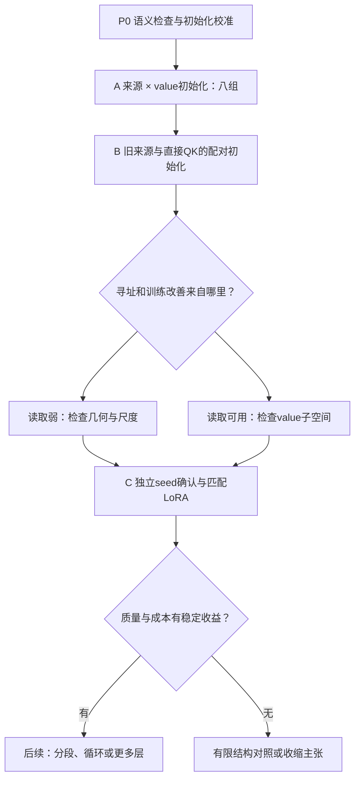

# RB 后续改进方案：直接输入投影、寻址初始化与梯度子空间

**主骨干：Qwen/Qwen3-0.6B-Base**  
**版本：1.0｜日期：2026-11-02（Asia/Tokyo）**  
**承接：研究计划 v2.1，以及用户提供的 RB1 / E-0021 结果摘要。**  
**状态：研究设计与数学核算完成；下述新增训练、初始化改造和 GPU 实验尚未执行。**

> 本方案把用户提出的 **直接使用原始块输入 \(XA_q,XA_k\)** 列为首轮必做实验。先只取消 Q/K 复用、保留原 V，随后独立测试 Q/K/V 全部直接投影。两种来源都与当前 RB1-09 和普通 LoRA 比较，同时给予旧路线与新路线梯度初始化机会。目标是定位当前方法不如 LoRA 的原因，验证哪些改进具有独立贡献。

## 阅读导航

- **第 1 节：最先执行的八组实验，以及用户新增想法在哪里验证。**
- 第 2–4 节：完整公式、输入位置、方法差异与可重参数化的边界。
- **第 5 节：零出口、配对 Q/K、激活 SVD、任务梯度 SVD 和尺度校准。**
- 第 6 节：可训练参数、LoRA 匹配、MAC 和状态核算。
- **第 7–10 节：P0 / A / B / C 的运行矩阵、数据协议和确认规则。**
- 第 11–13 节：诊断、条件扩展、100M 上限预算与停止条件。
- 第 14–16 节：待实现配置、伪代码、第一批交付和参考资料。

本文中的 **“用户报告”** 指本次提供的结果摘要；**“推导”** 指在明确假设下的代数结论；**“提议”** 指待执行实验。新实验 ID 使用 A01、B01 等，不修改 E-0021、RB1-09 或 v2.1 原有记录。

## 0. 当前证据、范围和研究目标

### 0.1 已知的起点

用户报告：普通设置下，RB1 / E-0021 的侧分支筛选中，点估计最高的路线为 RB1-09：四层 `[6,13,20,27]`、KernelMatrix、S1、r32、Q/K 取原 QKNorm 后且 RoPE 前特征、V 取原 v_proj、C_up 写回；它仍低于普通 LoRA。用户给出的可训练参数为925,696，batch1的四层 FP32 侧支持久状态为16,896字节。

这些配置和计数可用于本方案推导，但当前摘要没有给出逐 seed 指标、LoRA 完整配方、差值区间、初始化分布、数据清单和训练曲线。因此本文不把任何瓶颈写成“已经由日志证实”。在多个筛选组中点估计最高，也不等于已经完成独立确认。

分段设置的 R_keep 保持原有记录。由于本次摘要没有完整给出其 reset、跨段状态保留和原 attention KV 可见性定义，本方案不重新解释它。先完成普通 context-retained 设置；如迁移到分段设置，须使用 R_keep 自己的协议和成对对照，另计预算，不把两种信息访问条件的分数直接相减。

### 0.2 本轮四个问题

1. **特征入口：**直接从块输入学习 Q/K，是否比复用原多头 Q/K 更适合新增的低维寻址？
2. **Value 入口：**保留原 V 与直接投影 X 的差别，来自信息来源、逐 token 尺度，还是优化参数化？
3. **初始化：**任务梯度子空间、激活子空间和配对 Q/K，是否分别改善早期收敛及最终同预算效果？
4. **适配价值：**这些改善能否超过相同层位置、相同 up 写回位置、近似参数匹配的普通 LoRA？

本轮先固定 S1。循环、扩层和更大模型后置。C_up 是当前用户报告的较好路线，因此作为主写回接口；**R_res 保留明确的条件复核组 K05**，不再通过含混的“融合筛选”将原始块级残差旁路隐去。

### 0.3 与 v2.1 的关系

本文是 RB1-09 后续的独立、聚焦执行方案，不覆盖 v2.1 的历史结果或全部探索树。[P01] 其中的100M是一个新的预算模板，不能自动视为旧480M规划的剩余额度。开始运行时按项目 ledger 记录已消耗、可复用、已取消和本轮新增费用。

## 1. 新增直接输入方案与第一批实验

### 1.1 用户新增方案是首轮必做项

严格定义 \(X_t\) 为 **当前 Transformer 块、input_layernorm 之前的 residual-stream 输入**。\(N_t=\mathrm{Norm}_1(X_t)\) 和 attention 之后的 FFN 输入 \(U_t\) 是另外两个张量。

| 来源代码 | 低维 Q/K | 低维 V | 地位 |
| --- | --- | --- | --- |
| T | 原 QKNorm 后 Q/K，再乘 A_q/A_k | 原 V 再乘 A_v | 当前 RB1-09 参照 |
| **D-QK** | **\(X_tA_q,\ X_tA_k\)** | **\(V_tA_v\)** | **用户要求的最小改动；首轮必做** |
| **D-QKV** | **\(X_tA_q,\ X_tA_k\)** | **\(X_tA_v\)** | **独立检查取消 V 复用的作用** |
| N-QK | \(N_tA_q,\ N_tA_k\) | \(V_tA_v\) | 数值/优化对照，不替代 D-QK |
| N-QKV | \(N_tA_q,\ N_tA_k\) | \(N_tA_v\) | 函数映射与 value 参数化对照 |

原 attention 在所有来源中都正常运行；“取消复用”只指侧支的特征入口，不删除主干 attention 的 Q/K/V 计算。

### 1.2 第一批八组

保持四层、r32、S1、C_up、inclusive、相同数据与损失不变。I-R 为当前随机 value 初始化，I-G 为对应来源的历史混合特征梯度 SVD；两者均保留 C_u=0。具体初始化与尺度规则见第5节。

| ID | 条件 | 直接回答的问题 |
| --- | --- | --- |
| A01 | T + I-R | 当前路线的同协议参照 |
| **A02** | **T + I-G** | **仅改善初始化能否修复旧路线** |
| **A03** | **D-QK + I-R** | **\(XA_q,XA_k\) 的直接效果** |
| **A04** | **D-QK + I-G** | **直接 Q/K 与梯度初始化能否结合** |
| A05 | D-QKV + I-R | 再取消 V 复用会怎样 |
| A06 | D-QKV + I-G | 全部直接输入的任务相关子空间 |
| A07 | 同四层仅 up 的普通 LoRA，rank56 | 接近 T 的925,696参数预算 |
| A08 | 同四层仅 up 的普通 LoRA，rank48 | 接近直接输入的794,624参数预算 |

每组最多2M非padding输入token exposures，八组最多16M；P0校准最多2M，故**第一批上限18M**。真实数据还受登记epoch上限约束。A01/A02/A03/A04全部完成前，不依据随机初始化排名淘汰 T 或 D-QK。

### 1.3 探索路线



所有来源继续使用 KernelMatrix。读算子替换不是本轮来源或初始化实验的一部分；如果以后另测 SoftmaxSlot，必须独立命名并重新计算状态与读取成本。

## 2. 统一模型与来源分支

本节区分三类陈述：**已有结构**指用户描述的 RB1-09；**推导**指由给定公式得到的关系；**提议**指需要新实验验证的修改。以下统一采用行向量，省略 batch 维度和层下标。

### 2.1 三个不同的隐藏态

$$
X_t\in\mathbb R^D,\qquad N=\operatorname{Norm}_1(X),\qquad
H=X+\operatorname{Attn}(N),\qquad U=\operatorname{Norm}_2(H).
$$

- **X：原 Transformer 块的残差流输入。** 用户提出的直接输入分支明确使用这个 X。
- **N：原 input_layernorm 的输出。** 它是原 attention 的输入，仅作为单独命名的归一化对照。
- **U：原 post_attention_layernorm 的输出。** 它是原 FFN 输入，已经经过本块 attention；不能用 U 替代 X 后仍称相同方案。

Qwen3-0.6B-Base 的本研究配置为 D=1024、FFN 中间宽度 m=3072、28 层、16 个 query heads、8 个 KV heads、head_dim=128；Q 投影总宽度2048，K/V总宽度1024。[R01] [R02] 所有正式运行锁定实际模型与实现 revision。

原块为：

$$
\mathcal B(X)=H+F(U),\qquad
F(U)=[\operatorname{SiLU}(UW_g)\odot UW_u]W_d.
$$

原主干参数冻结，但梯度仍须通过冻结主干回传到更早层的适配器。以下新侧支均保留原 attention，不减少其合法上下文访问。

### 2.2 来源候选：必须保留 literal X 分支

原投影特征定义为：

$$
\widetilde Q=\operatorname{QKNorm}_q(NW_q),\quad
\widetilde K=\operatorname{QKNorm}_k(NW_k),\quad V=NW_v.
$$

Q/K取原逐头QKNorm之后、RoPE之前；K/V在GQA重复之前。以下标签仅定义结构，具体运行编号由实验矩阵指定。

| 来源标签 | 低维 query | 低维 key | 低维 value | 定位 |
| --- | --- | --- | --- | --- |
| T：原特征参考 | \(\widetilde Q A_q\) | \(\widetilde K A_k\) | \(V A_v\) | 复现当前RB1-09 |
| **D-QK：直接Q/K** | **\(XA_q\)** | **\(XA_k\)** | **\(V A_v\)** | **用户要求的最小改变，必须独立验证** |
| **D-QKV：全部直接** | **\(XA_q\)** | **\(XA_k\)** | **\(XA_v\)** | **进一步改变value来源** |
| N-QK | \(NA_q\) | \(NA_k\) | \(V A_v\) | D-QK的归一化/参数化对照 |
| N-QKV | \(NA_q\) | \(NA_k\) | \(NA_v\) | 标准化的全部直接投影 |

T中，Aq为2048×r，Ak/Av为1024×r；所有direct候选的三路矩阵均为1024×r。各层参数独立。**D-QK先隔离寻址入口，D-QKV再检验value入口；不能把两种修改合成一次比较后归因。**

### 2.3 所有来源共用的因果读取

采用不带可训练仿射项的低维RMSNorm：

$$
\mathcal N_r(z)=\frac{z}{\sqrt{\operatorname{mean}(z^2)+\epsilon_N}},
\qquad \phi:\mathbb R\rightarrow\mathbb R_{>0}.
$$

phi、epsilon_N与读取epsilon首先沿用实际RB1-09，并在P0登记。用户摘要尚未提供其具体值。若另立共同新配方，可预登记ELU+1与epsilon=1e-6作为候选；这不是对旧运行配置的断言。改变phi属于独立读算子实验。

$$
\kappa_t=\phi(\mathcal N_r(\bar k_t)),\quad
M_t=M_{t-1}+\kappa_t^\top\bar v_t,\quad
c_t=c_{t-1}+\kappa_t^\top.
$$

$$
\rho_t=\phi(\mathcal N_r(\bar q_t)R_q),\qquad
a_t=\frac{\rho_tM_t}{\rho_tc_t+\epsilon},\qquad Z_t=\eta a_tR_o.
$$

首轮固定S1、r32、eta=0.25，Rq/Ro为32×32单位阵。每个有效token先写一次、再读一次；padding不写，样本边界同时重置M/c；状态FP32累积。训练前缀、分块prefill和逐token decode须遵守同一因果定义。[R03]

### 2.4 写回接口保持明确

主候选沿用当前有信号的C_up：

$$
Y_t=H_t+[\operatorname{SiLU}(U_tW_g)\odot(U_tW_u+Z_tC_u)]W_d,
\qquad C_u\in\mathbb R^{r\times m}.
$$

Cu零初始化，侧支内部非零初始化，开始时与Base一致。保留块输出残差接口用于独立比较：

$$Y_t^{R}=\mathcal B(X)_t+Z_tP_R,\qquad P_R\in\mathbb R^{r\times D}.$$

两种接口使用同源Z，但插入位置不同。C_up改变本块FFN的up输入；R_res在本块原FFN完成后相加。不得把C_up的结果自动记作R_res的验证。

## 3. 与普通LoRA的差异与诊断

### 3.1 S1的精确等价形式

令value的未压缩来源为F：T/D-QK/N-QK使用F=NWv，D-QKV使用F=X，N-QKV使用F=N。定义实际权重：

$$
w_{t,i}=\frac{\rho_t\kappa_i^\top}{\sum_{j\le t}\rho_t\kappa_j^\top+\epsilon},
\qquad p_t^F=\sum_{i\le t}w_{t,i}F_i.
$$

由于value与读后映射线性：

$$a_t=p_t^FA_v,\qquad
\boxed{\Delta\mathrm{up}_t=p_t^FB_{\mathrm{eff}},\quad B_{\mathrm{eff}}=\eta A_vR_oC_u,\quad\operatorname{rank}(B_{\mathrm{eff}})\le r.}$$

这个重排包含epsilon仍然精确；epsilon可忽略时权重和为1。普通up-LoRA的输入则是当前FFN状态：

$$\Delta\mathrm{up}^{\mathrm{LoRA}}_t=U_tA_LB_L.$$

因此，RB方法需要学习适合任务的历史混合，LoRA可以直接适配已经过原attention处理的U。[R04] direct投影降低了寻址入口的参数量，但没有自动消除这一信息来源差异。

对C_up，块输出修正也有精确表达：

$$\Delta Y_t=[\operatorname{SiLU}(U_tW_g)\odot p_t^FB_{\mathrm{eff}}]W_d.$$

原gate允许当前U调制历史信息；C_up分数较好不单独证明权重已学会选择性读取。S1中Ro可折叠进Av或Cu，其主要作用是改变优化参数化；部署折叠与训练时删除Ro是不同操作。

### 3.2 必须测量的读取与优化量

正权重不是缺陷，softmax也使用正归一化权重；问题在于当前核是否能区分相关与无关位置。Hedgehog研究了线性注意力的权重尖锐度与点积单调性，这支持测量相关性质，但不证明本模型已发生相同失败。[R09]

对实际权重重新归一到和为1后，记录：

$$n_{\mathrm{eff}}(t)=\frac1{\sum_iw_{t,i}^2},\qquad
\mathcal H_t=-\sum_iw_{t,i}\log w_{t,i}.$$

同时记录分母、原权重和、当前token权重、最大权重、写入年龄分布、读出RMS和中心化RMS。按前缀长度分桶，不能仅用全样本均值掩盖长前缀退化。

若中心化values独立且将权重视为固定，则有示意关系：

$$\operatorname{Cov}(a_t)=\left(\sum_iw_{t,i}^2\right)\Sigma_v=\Sigma_v/n_{\mathrm{eff}}.$$

真实values相关、权重依赖输入，不可把该近似当作实测定律；有非零均值时输出可能趋近公共均值，而非总范数趋零。

记录各参数组的梯度RMS及相对更新量RMS(Δθ)/RMS(θ)，而非直接比较不同尺寸矩阵的Frobenius范数。对Cu等零初始化参数，首步报告绝对更新RMS，或使用明确登记的分母epsilon，避免相对更新比除零。Cu启动后仍长期没有Q/K任务梯度，才进一步检查detach、错误的no_grad或跨优化步复用旧memory。

### 3.3 零出口为何需要更好的初始特征

定义d_t为up加法点的任务梯度，它已包含原gate/down与后续主干的反向作用：

$$\nabla_{C_u}\mathcal L=\eta R_o^\top\sum_ta_t^\top d_t.$$

Cu=0时，其余侧支参数的首步任务梯度为0；AdamW权重衰减仍可能改变非零参数，但那不代表获得了任务信息。普通LoRA也采用零出口，因此这本身合法。[R04] [R06] 应检查初始读出是否给出口提供足够有用的方向，以及出口更新后寻址是否启动。

### 3.4 直接投影仍未解决的结构限制

直接Q/K可提供更清晰的共同输入坐标，但仍只有一个r32的核读取。它没有自动恢复原16个query heads的独立检索，也没有把每个历史token单独保留；当任务需要同时辨认多个细粒度事实时，压缩与混合本身仍可能成为瓶颈。

M/c的加法状态没有显式遗忘项或额外相对位置机制。在固定的侧支key/value向量集合上，求和对排列不敏感；但X和原Q/K/V来自上下文相关的主干，不能据此声称整个模型对词序不敏感。先测量按年龄分桶的权重、前缀长度与任务表现，再决定是否增加衰减或窗口。

此外，只在四层新增读取与在许多层直接修改权重，任务适配能力和预算分配均不同。如果用户当前的普通LoRA覆盖更多层，差距不能仅解释为初始化差。A07/A08提供相同四层、相同up接口的近参数对照；当前实际LoRA配方仍作为独立应用参照保留。

## 4. 直接输入的等价关系与边界

### 4.1 D-QK与N-QK：S1下主要是参数化对照

写原Norm1为：

$$N_t=X_t\Gamma/s_t,\qquad s_t=\sqrt{\operatorname{mean}(X_t^2)+\epsilon_{\mathrm{base}}},$$

其中Gamma是冻结的缩放对角阵。若设置Aq_X=Gamma Aq_N，则qbar_N=qbar_X/s_t，且：

$$
\mathcal N_r(\bar q_t^N)=
\frac{\bar q_t^X}{\sqrt{\operatorname{mean}((\bar q_t^X)^2)+\epsilon_Ns_t^2}}.
$$

它与直接归一化qbar_X的差别是有效epsilon。K同理。当epsilon不主导、value来源相同、S1且使用增量readout时，两者近似给出相同读取。Gamma可逆时可双向映射；若出现零缩放分量需另查。

因此，**N-QK不能被包装成与D-QK完全不同的表达能力假设**。比较仍有意义：默认随机初始化的坐标、参数梯度与优化器预条件并不等价，有限epsilon也可能影响稳定性。literal X仍须保留，N只是明确命名的对照。

边界：S>1累加循环保留未归一化z0，z0尺度不同而每步增量不相应缩放，通常破坏上述简单等价；S1完整state读出包含z0也同样如此。若value直接使用X或N，token相关的1/s_t未被value归一化抵消，不能由固定Av吸收。

### 4.2 保留原V与direct-N value：函数族和优化分开

$$\bar v^{\mathrm{old}}=(NW_v)A_v=N B_v,\qquad B_v=W_vA_v.$$

Wv为1024×1024。若满秩，direct-N value与保留原V的线性value函数族相同；秩亏时direct-N可能扩大可用空间。**去掉Wv不自动意味着更强表达能力。**

优化仍有区别。在其余部分固定的普通SGD下：

$$\nabla_{A_v}\mathcal L=W_v^\top\nabla_{B_v}\mathcal L,\qquad
\Delta B_v^{\mathrm{old}}=-\mathrm{lr}\,W_vW_v^\top\nabla_{B_v}\mathcal L,$$

而直接训练Bv给出ΔBv=−lr∇BvL。原Wv引入固定的预条件作用；AdamW同样没有一般的重参数化不变性。

提议增加同函数初始化：保持Q/K相同，先产生旧Av，再令direct-N的Bv=WvAv。比较a/Z而非仅看零出口logits，确认起点相同后再研究优化差异。这个同函数控制不适用于直接raw-X value，因为N含token相关尺度。

### 4.3 原Q/K能否合并，取决于QKNorm的位置

若取QKNorm之前的原线性投影，有：

$$NW_qA_q=N(W_qA_q).$$

Wq满行秩时，它与direct-N query有相同线性函数族，尽管旧Aq使用更多参数。当前T取逐头QKNorm之后：

$$\operatorname{QKNorm}(NW_q)A_q,$$

输入相关的逐头归一化一般不能合并进固定矩阵。故T与D-QK的比较同时涉及原投影基底、逐头非线性和低维参数化，不能只用“是否复用已有计算”解释。

## 5. 初始化方案

### 5.1 保留共同起点，区分独立与配对Q/K

所有纯初始化组保留Cu=0、Ro=I、Rq=I，原主干不变。不得同时把Av和Cu置零，否则value-to-up乘法路径可能无法启动。

direct候选的配对初始化为：

$$A_q^{(0)}=A_k^{(0)}=P_0,\qquad P_0\in\mathbb R^{1024\times r}.$$

使用两个独立Parameter并复制数值，后续独立训练；永久绑定是另一种参数共享结构。B阶段的P0直接复用对应A参照的Ak初值，保留Ak与Av全部数值，只将Aq改为配对值；随机初始化家族与fan-in规则保持一致。若另测列正交初始化，独立与配对两臂均使用同一家族，不只替配对组改变分布。共享初值使同token的rho与kappa相同，但不保证该token权重最大；phi后的范数仍可能不同。必须检查是否主要增强了self通路，而没有改善历史读取。

T的Q/K维度不同，不能直接Aq=Ak。可按原GQA映射将每个KV组的两个query头以1/sqrt(2)聚合，构造G_group∈R^(2048×1024)，再设：

$$A_q^{(0)}=G_{\mathrm{group}}P_0,\qquad A_k^{(0)}=P_0.$$

它只对齐聚合后的坐标，不恢复全部独立attention heads，也不保证保留softmax/RoPE。各自独立PCA同样不保证Q/K主轴可比较，不能当作配对初始化的替代。

### 5.2 I-G：对实际混合特征做任务梯度SVD

这是一项针对当前分支的**提议与推导**，借鉴LoRA-GA的梯度子空间思想，并非完整复刻其非零两端初始化。[R06]

先锁定来源、Q/K初始化与读权重，用训练侧校准样本计算p_t^F。令虚拟全秩矩阵B=0作用于up加法点，得到：

$$G_F=\left.\frac{\partial\mathcal L}{\partial B}\right|_{B=0}
=\sum_t(p_t^F)^\top d_t\in\mathbb R^{1024\times3072}.$$

它不同于原Wu梯度ΣU_t^T d_t。收集d_t时应允许梯度经过冻结主干，在up加法点保留激活梯度，不要求更新原权重。padding不计；按正式loss的归一化规则累积。有效位置不只包含直接有label的答案位置：prompt位置若通过后续计算影响loss，其非零d也应计入，不能再次套答案loss mask将它删掉。

$$G_F=U_G\Sigma_GV_G^\top,\qquad
\boxed{A_v^{(0)}=U_{G,[:,1:r]},\quad R_o=I,\quad C_u=0.}$$

普通SGD、无衰减、只看第一步时：

$$\Delta B_{\mathrm{eff}}=-\mathrm{lr}\,\eta^2U_{G,r}U_{G,r}^\top G_F
=-\mathrm{lr}\,\eta^2G_{F,r}.$$

这是对应虚拟value-to-up梯度的rank-r截断方向。若第5.4节再将Av乘以每层标量s，右侧相应变为\(-\mathrm{lr}\,\eta^2s^2G_{F,r}\)，方向不变而步幅改变。AdamW下不再是精确截断梯度，但仍提供有任务依据的输入子空间；不宣称等价于全参数微调。

实施顺序：固定训练校准样本与长度分布；锁定Q/K；收集对应p/d；累计G；做截断SVD；赋值Av并校准尺度；重新建立正式训练optimizer。不同来源、不同Q/K初值须分别重算G。标签与前后向成本计入初始化成本。

### 5.3 I-A：对实际混合特征做激活SVD

将p_t^F堆成矩阵P，做P=U_PΣ_PV_P^T，设置：

$$A_v^{(0)}=V_{P,[:,1:r]},\qquad R_o=I,\qquad C_u=0.$$

这是EVA式激活子空间思想在本分支上的改写。[R05] 选择对象是实际历史混合特征，而非机械分解原Wu或原始V。首轮使用明确登记的未中心化激活SVD；若改为中心化PCA或白化，单独命名并报告，不能静默加入前向去均值。

高能量方向不一定具有任务价值，可能主要捕获公共背景。比较I-A与I-G能够区分“保留激活能量”和“对齐任务修正方向”。

### 5.4 尺度与学习率独立校准

Q/K整体随机标准差通常被低维RMSNorm近似抵消，不作为主要搜索方向。Av没有这一抵消：在固定读权重下，乘标量s会同比缩放a/Z。

可在训练校准集计算每层Z的RMS，并用预先指定的参考尺度sigma_star定义：

$$s_\ell=\frac{\sigma_\star}{\operatorname{RMS}(Z_\ell)+\epsilon_s},\qquad A_{v,\ell}\leftarrow s_\ell A_{v,\ell}.$$

主矩阵中，sigma_star取同来源、同Q/K初值、同校准样本下的随机Av参照读出RMS；A04对A03，B04对B03，其他组类推。匹配总RMS后仍报告中心化RMS，避免公共均值掩盖信息退化。参考尺度、允许范围与校准长度分布须在比较前锁定。若需要极大增益才达到目标，先标记读出退化，不无界放大。方向初始化组使用可比尺度；尺度单独组才能支持尺度归因。Cu=0使这些初始化仍保持Base输出。

eta=0.25和eta=1可作为单独缩放对照，但不能把AdamW下eta差异等同于简单学习率比例。出口Cu与内部参数可使用分组LR；LoRA+提供相关优化动机，其具体比例不能直接照搬至本多参数组结构。[R07]

### 5.5 不直接套用的非零初始化与条件预热

PiSSA与完整LoRA-GA可以通过静态权重补偿保持初始函数。[R06] [R08] 本分支作用于p_t^F，而原up作用于U_t，一般不存在固定D满足U_tD=p_t^FB对所有前缀成立，因此不能从Wu减去一个静态矩阵就抵消任意动态初始旁路。

随机非零Cu属于近似函数保持实验，应报告初始logits偏移和NLL；不能与严格零出口混称。用冻结初始动态分支相减可精确抵消，但需额外状态/计算，且冻结参数不意味着可以丢弃其输入Jacobian；本轮不作为优先方法。

若测得寻址始终退化，可保持Cu=0，用直接作用于a的辅助读取损失预热Q/K。LoLCATs的attention transfer提供参考，但它替换原attention，本研究保留原attention，模仿原模块可能只得到冗余功能。[R10] Teacher维度、可用信息和预热预算须明确；单个r维读取不能被要求完整复制16个独立heads。

## 6. 参数与成本

### 6.1 可训练参数

以下保留Rq/Ro、无bias、无side Norm仿射、S步共享；适配层数L_a=4。C_up每层参数：

$$P_T/L_a=7168r+2r^2,\qquad P_D/L_a=6144r+2r^2.$$

| 配置 | 每层参数 | 四层参数 |
| --- | ---: | ---: |
| T，r32，C_up | 231,424 | 925,696 |
| D-QK或D-QKV，r32，C_up | 198,656 | 794,624 |
| direct，r37，C_up | 230,066 | 920,264 |
| direct，r32，R_res | 133,120 | 532,480 |

所有N对照与对应direct-X候选参数相同。r32时节省131,072个参数，来自query压缩入口2048→1024。配对初始化不永久绑定参数，不减少计数。

同四层仅up的普通LoRA为P=4(1024+3072)r_L：[R04]

| LoRA配置 | 参数 | 对应比较 |
| --- | ---: | --- |
| up rank32 | 524,288 | 相同低秩宽度的当前输入适配 |
| up rank48 | 786,432 | 比direct-r32少1.03% |
| up rank49 | 802,816 | 比direct-r32多1.03% |
| up rank56 | 917,504 | 比原T-r32少0.89% |

两层rank48、两层rank49可精确达到794,624，但位置必须预先固定。r37的direct组比原T-r32少0.59%，只是近参数对照；不得把它与r32组称为同状态容量或同实测延迟。

### 6.2 算术量与状态

每个token写一次、读S次，按未折叠的最小实现，忽略Norm/激活/分母等标量操作：

$$\mathrm{MAC}_T\approx L_a[7168r+(1+3S)r^2],\qquad
\mathrm{MAC}_D\approx L_a[6144r+(1+3S)r^2].$$

四层S1时，T-r32为933,888 MAC/token，direct-r32为802,816，direct-r37为931,216。S1部署可折叠RoCu，但所有候选须采用同等优化，再实测prefill/decode；这些算术值不是速度预测。

FP32的侧支M/c状态为：

$$B_{\mathrm{state}}=4L_a(r^2+r)\ \mathrm{bytes}.$$

四层r32为16,896 bytes，即16.5 KiB；r37为22,496 bytes。来源改变不改变同r的状态大小。这是batch1的侧支持久状态，不含原attention KV、训练激活、beam复制或其他缓存。

**原attention仍然计算原Q/K/V。** direct分支节省的是新增query压缩的维度，不是删除了原主干投影；整个模型也没有因此变成常数状态模型。初始化的校准前后向、SVD和临时完整value混合状态另报成本。

## 7. P0：证据、校准和实现检查

### 7.1 固定实际实验条件

首先记录 E-0021 / RB1-09 的实现commit、模型/tokenizer revision、数据manifest、学习率、训练token/step、随机初始化类与方差、实际phi、低维Norm epsilon、损失mask、checkpoint选择规则和LoRA配方。

若当前实现的phi不是v2.1默认的ELU+1，所有A/B组首先沿用实际phi。更换phi另立对照。不能用一个重新实现的T组静默替代当前RB1-09，再将数值差异全部归因于来源。

当前数据定义应优先沿用RB1的普通设置。如果原数据登记无法取得，可以使用v2.1的PIQA/BoolQ训练混合作为新登记任务，但必须重跑T和LoRA，并明确不是旧结果的直接复现。[P01] 已在筛选中反复查看的validation不重新称为封存确认集。

### 7.2 针对性检查

| 检查 | 必须核实的内容 |
| --- | --- |
| 输入位置 | D-QK确实读取块Norm之前的X；不偷换为N或U |
| 主干次数 | 原attention与FFN各执行一次；低维侧支不重跑原块 |
| 零出口 | 每种来源在C_u=0时均保持Base函数；不能据此证明内部路径相同 |
| 内部梯度 | 首步只有出口有任务梯度；出口更新后Q/K/V压缩与R_q/R_o取得预期梯度 |
| 共享初始化 | Q/K数值复制后是独立参数对象；后续没有意外永久共享 |
| 因果读取 | 矩阵prefix实现与显式同核权重读出一致；改后缀不影响前缀 |
| inclusive | 当前有效token只写一次，再读；改变S不增加本token的写次数 |
| reset与padding | 样本隔离、pack边界、batch/beam重排正确；padding不写、不读 |
| 分块一致 | 单次prefill、分块prefill、逐token decode在相同协议下等价 |
| 函数映射 | rawX/N的QK方向映射检查；原V到direct-N-value的精确映射检查 |
| 冻结梯度 | 冻结的是主干参数，不是主干的输入Jacobian |
| 初始化fan-in | 本文A写为din×r；如用PyTorch Linear的初始化函数，按其r×din权重布局处理，不能误把r当fan-in |

函数映射比较必须看q/k、低维value、M/c、a/Z；也可使用共同非零出口fixture。仅看零出口logits会把不同内部函数都误判为相同。

### 7.3 校准预算与数据

P0总上限2M输入exposures，建议拆为：

- **≤1M初始化校准exposures：**训练侧样本上的特征统计、必要反向、梯度/激活SVD；每个初始化候选实际使用的样本暴露分别入账。
- **≤1M短优化：**T、D-QK、D-QKV、up-LoRA-r48、up-LoRA-r56五个家族，各2个LR候选，各0.1M。共10个短run。只用于稳定性与配方校准，不作最终排名。

已有经过登记的可靠LR可以继续使用，并省去对应run；不强迫把预算用完。缺少历史配方时可先登记{1e-4,3e-4}作为两点候选，若实际RB1已使用不同量级则以它和一个预登记邻近值替换。保持候选数量和预算相同，不在看过确认集后扩大网格。

A/B的首选控制规则是：从两个候选中选出在T、D-QK和D-QKV都稳定的共同reader LR，I-R/I-G共享该LR；两项LoRA获得相同调参机会，可各自使用锁定的LR。若不存在共同稳定LR而必须按来源分别选LR，则来源差分解释为“同等调参机会后的完整来源配方效果”，不能声称严格只改变输入来源；需要纯来源归因时，从储备增加共同LR桥接对照。B继承其对应A的LR，不再次单独优化。

初始化校准与dev/确认分开。梯度SVD使用了任务标签和反向计算，应完整记录；普通LoRA作为现实基线保留，并获得上述公平LR校准。本轮因此比较的是完整方法及其成本，不把初始化数据处理称为免费。

### 7.4 初始化数据处理的实现方式

令所选来源的未压缩value输入为F_t，固定该候选初始Q/K，使用临时状态：

$$M_t^{\mathrm{full}}=M_{t-1}^{\mathrm{full}}+\kappa_t^\top F_t\in\mathbb R^{r\times1024}.$$

则可以直接得到：

$$p_t^F=\frac{\rho_tM_t^{\mathrm{full}}}{\rho_tc_t+\epsilon},$$

无需构建T×T权重矩阵。临时full-value状态仅用于初始化数据处理，不作为部署的低维memory。

在原FFN up输出加法点取得d_t。可通过临时零加法叶张量或正确保留激活梯度实现，不要求让原W_u成为可训练参数。必须允许后续冻结网络反传；不能把整段校准前向放在no_grad后仍期待得到d_t。

P0的1M初始化额度覆盖所有新候选和确认seeds的校准暴露，不是每组各1M。先登记每次使用量；例如11次各64K约为704K，其余额度留给必要重算，实际次数随所选初始化而定。缓存复用时同时记录实际主干前后向次数与各候选使用的逻辑样本暴露，不能重复把校准当作免费。

各层独立累积G_F，随后做截断SVD。只有在整个主干状态仍处于Base、所有侧支出口为零且所有配置输入一致时，才可跨初始化候选复用冻结主干特征和d_t。Q/K或value来源改变后，对应p_t和G_F要重新计算。正式多层训练中，上游adapter会改变下游输入，不得跨优化步复用旧的下游特征或含可训练投影的memory。

## 8. A与B：来源和初始化分开验证

### 8.1 A阶段固定条件

第1.2节八组是正式矩阵。默认四层 `[6,13,20,27]`、r32、S1、context-retained、C_up、每有效token因果先写后读、无额外辅助损失。R_q=R_o=I，C_u=0，eta=0.25。

A阶段的Q/K均使用独立随机初始化。T沿用实际RB1初始化；D组使用相同初始化家族及正确的din，记录seed和真实矩阵范数。若实际旧初始化未知，须在release中说明采用了新的共同初始化规则，不能声称A01已复现旧训练。

在每个source内部，I-G使用与I-R完全相同的Q/K初始数值，并将SVD后的A_v缩放到该source的I-R读出RMS参考。eta/LR不同时改变。跨source的原始X-value尺度本身可能不同：A05/A06检验的是完整输入方案，不能把所有分数差直接归因于语义信息。需要进一步归因时，使用K01/K02做跨source尺度匹配。

共同数据顺序、样本预算、标签mask、eval频率和checkpoint规则均固定。若使用同一随机seed，须按矩阵角色生成随机流，避免一个矩阵维度变化引起所有后续参数的随机数偏移。

### 8.2 A阶段的预定义比较

令J为越大越好的任务指标，例如宏平均准确率或负NLL：

$$\Delta_{QK}^{R}=J(A03)-J(A01),\qquad \Delta_{QK}^{G}=J(A04)-J(A02),$$

$$\Delta_{V}^{R}=J(A05)-J(A03),\qquad \Delta_{V}^{G}=J(A06)-J(A04),$$

$$\Delta_{G}^{T}=J(A02)-J(A01),\quad\Delta_{G}^{D-QK}=J(A04)-J(A03).$$

上述差分及以下交互在共同reader LR、共同训练规则下可用于来源与初始化的析因；采用来源专属LR时，改为完整配方间的描述性差分。

来源与梯度初始化的交互：

$$\Delta_{\mathrm{interaction}}=[J(A04)-J(A03)]-[J(A02)-J(A01)].$$

A01/A02分别与A07比较；A03–A06分别与A08比较。两种LoRA的全部原始结果都报告，避免按方法挑选有利的基线。

第一轮一个seed只作筛选。曲线仍快速改善但预算耗尽时，结论是“该预算下未完成”，不是证明更长训练无效。没有稳定的可学性或数值正确性时，不解释初始化优劣。

### 8.3 B阶段：补齐配对Q/K初始化的析因

必须同时保留T和D-QK，不只给A阶段胜者使用组合初始化。

| ID | 条件 | 与哪些已有组构成对照 |
| --- | --- | --- |
| B01 | T：GQA配对Q/K + 原随机A_v | 对A01，只改变Q/K初始数值 |
| B02 | T：GQA配对Q/K + 重新计算I-G | 对A02/B01，分解配对与梯度初始化 |
| B03 | D-QK：A_q=A_k的初始复制 + 原随机A_v | 对A03，直接输入的共同几何 |
| B04 | D-QK：初始复制Q/K + 重新计算I-G | 对A04/B03，检验组合效果 |

每组最多2M，共8M。与A使用相同训练预算、数据顺序和seed；若这些条件完全相同，A01–A04可以直接复用，不再重跑。

至此T和D-QK都有四格：独立Q/K+随机A_v、独立Q/K+梯度A_v、配对Q/K+随机A_v、配对Q/K+梯度A_v。D-QKV已在A中得到随机和梯度两种机会，但未自动展开配对四格；可由明确诊断从储备中补充，不能把未测试组合写成失败。

**纯Q/K消融：**B01/B03保留参照组A_v矩阵的全部数值，不重新做SVD。Q/K变化会改变读取分布及其尺度，这属于完整的Q/K初始化效应；如需进一步区分方向与尺度，另做固定增益控制，不把它藏进该组。

**组合初始化：**B02/B04必须先锁定配对Q/K，再重算p/G、初始化A_v，并匹配各自B01/B03的读出RMS。不能沿用A02/A04旧权重下的G，却称为配对读取的梯度初始化。

### 8.4 进入确认的选择规则

- 旧来源T和literal D-QK均必须完成上述必要机会。
- 按预登记dev宏平均选择T的最佳初始化，以及D-QK/D-QKV中的直接输入候选D*；近似持平时采用预先规定的更简单初始化/更低校准成本规则。
- 选中D-QKV时，不得把它的收益全部归因于取消Q/K复用；A03/A04提供QK-only证据。
- D*的选择范围和实际HPO次数全部记录。直接输入候选的选择收益需要后续确认集检验。
- 如果所有attention候选都明显输给匹配LoRA且无改善趋势，先释放一个诊断对应的储备实验，不立即扩大S或层数。

## 9. C阶段：独立确认

### 9.1 五组方法、三个新训练seeds

| ID | 条件 | 主要比较 |
| --- | --- | --- |
| C01 | T原初始化 | 当前路线的新seed参照 |
| C02 | T最佳已锁定初始化 | 初始化改善旧路线的程度 |
| C03 | D*最佳已锁定初始化 | 直接输入的最终候选 |
| C04 | 同四层up-LoRA rank56 | 旧路线近参数标准基线 |
| C05 | 同四层up-LoRA rank48 | 直接路线近参数标准基线 |

每方法3个训练seeds、每run最多4M输入exposures，总上限60M；仍受真实任务最多3epochs或项目已登记更严格上限约束。T最佳若等于原初始化，合并C01/C02，减少实际预算。确认阶段固定输入来源、初始化方法、校准规则、LR、模板、max_length与checkpoint选择规则。

建议筛选seed0、确认seeds17/29/43；如这些seeds已用于同一数据命名空间，应另行登记。对于随机初始化，每个训练seed独立产生初始矩阵；梯度初始化使用同一个训练侧calibration清单和固定算法，但需针对各自Q/K计算G。跨seed结果是在该校准清单条件下的结果；校准样本选择的不确定性需要另外实验。

### 9.2 主要统计比较

主要实用比较：C03对C05。来源/优化解释比较：C03对C02。初始化比较：C02对C01。C03对C04也完整报告，作为更高LoRA参数预算的参照，不称同参数。

主报告包括逐任务指标、宏平均、NLL、每seed值、均值/标准差以及配对区间。按独立样本或episode重采样，同一图包含多个query时以episode为单位。数据bootstrap不能替代训练seed数量；3个seeds不能精确描述全部训练随机性。

默认提议使用95%配对区间，多个并列主要比较采用预登记的Holm控制。最小实用差可以在开封前登记为宏平均+1个百分点、每任务不下降超过1个百分点；这只是建议的研究门槛，不是已有实验判据。还必须同时报告延迟与显存成本。

如果实际确认集已用于RB1结构选择，应如实标记重复使用。优先新增未参与选择的保留集/任务，或将本轮称为新seed复核，不通过改文件名虚构独立测试。

### 9.3 三类结论分开

1. **质量改善：**同数据预算与合理调参下，任务指标提高。
2. **参数效率：**与对应预算LoRA比较，不能只与另一rank的数字选择性比较。
3. **历史读取机制：**需要同源tokenwise、状态干预和读取轨迹证据。C阶段的任务胜出本身不等于证明使用了侧支历史；相关对照见K04/K05与第11节。

## 10. 公平性与信息访问协议

### 10.1 主协议固定

所有A/B/C组保留原attention的完整合法因果上下文；每个样本的侧支状态从零开始。普通teacher-forcing中每个token只影响它之后的预测，loss采用正确的shift与mask。答案token作为后续位置的历史与把未来答案写入当前预测是两回事，必须由显式因果索引保证。

不混入memory-only或分段R_keep结果。分段迁移时额外登记：段长、重置对象、跨段M/c保留、主干KV保留、position IDs、支持/问题边界及读取/写入scope。

### 10.2 训练与校准公平

- 五个家族使用相同数量的短LR候选和同等样本预算。
- I-G的校准标签、反向和SVD成本全部记录；若对LoRA使用EVA/LoRA-GA等增强基线，另明确其初始化预算，不能把它们混写成“普通LoRA”。
- 同步报告按训练token对比和包含初始化后的wall-clock对比；不能由一种推出另一种。
- 校准完成后，正式训练从指定初始化和新optimizer开始；不把校准过程中的任务训练权重偷偷带入某一组。
- 多层训练保留冻结主干的输入梯度，不缓存过时的下游hidden state。
- 新增状态用FP32累积；dtype、autocast与梯度精度统一登记。优化kernel前，先保证参考语义正确。

### 10.3 LoRA基线的正确解释

同四层、仅up的rank48/rank56控制的是插入位置和近参数预算。若现有“普通LoRA”是全28层all-7，它仍应作为实际应用参照保留，但不属于这两项单因素对照。只有任务、数据、budget、seed和评估规则一致时才复用旧结果，否则重新登记所需训练费用。

同rank32的up-LoRA只有524,288参数，可作为低成本结构参考。原R_res与直接输入R_res的参数不同；同r并不等于同参数。不能据一个C_up对R_res原始分数差宣称接口参数效率。

## 11. 诊断仪表与原因判别

### 11.1 不增加正式训练即可做的检查

在初始化、首步后以及约10/100/500步或等距token里程碑保存如下统计；诊断位置和抽样集合在看结果前固定。

| 类别 | 记录项 | 解释边界 |
| --- | --- | --- |
| 读取选择性 | max weight、self weight、历史总权重、归一化熵、n_eff | 配对初始化可能增大self权重，不自动等于历史检索变好 |
| 位置与长度 | 上述指标按前缀长度、相对年龄分桶 | 无遗忘累积可能随长度改变混合程度 |
| Value信息 | a/Z总RMS、中心化RMS、token间cosine、协方差谱 | 公共均值较大时，总范数不小也可能丢失差异 |
| 优化 | 各组grad RMS、相对更新量、clip频率、Cu范数 | 不用不同参数量的总梯度范数直接排名 |
| 数值 | 分母分位数、epsilon占比、M/c范数、非有限值 | epsilon主导时rawX/N近似映射可能不成立 |
| 任务 | train/dev loss、逐任务准确率、能力保持NLL | 区分优化不足、泛化差与评估天花板 |
| 成本 | 初始化token/反向/SVD时间、训练吞吐、prefill/decode、状态字节 | 侧支常数状态不等于整个模型常数状态或加速 |

若权重和因epsilon明显小于1，统计熵/n_eff时另用归一化后的权重，并同时报告总质量，不能隐藏数值异常。

### 11.2 冻结干预

保持原attention KV不变，仅对侧支比较正常历史、清空历史、短窗口、同形状跨样本状态交换、破坏K/V关联以及均匀读取。当前token单槽归一化read会使Q/K近乎抵消，只能作为推理干预，不能冒充有效参数完全相同的训练基线。

冻结干预存在分布偏移，必须与训练匹配T0共同解释。当前源Q/K/V或X本身含上游上下文，所以“无侧支历史”不等于整个模型无历史。

### 11.3 结果到下一步的对应关系

| 观察结果 | 当前合理解释 | 下一步 |
| --- | --- | --- |
| D-QK在I-R/I-G均优于T | 取消原Q/K路径有稳定价值 | 确认来源效果，保持S1 |
| 仅D-QK+I-G有效 | 来源与初始化交互 | 保留完整四格，不只发布最高分 |
| T+I-G追平D-QK | 旧路线可能主要受value初始方向限制 | 依据成本选更简单方案 |
| D-QKV优于D-QK | value来源或逐token尺度重要 | 用rawX/N与同函数映射进一步定位 |
| 配对后只提高self权重、去历史不影响 | 当前token通路可能解释提升 | 与T0/local-LoRA比较 |
| n_eff长期接近前缀长度且梯度弱 | 读取区分度可能不足 | 有界尺度对照或读取预热 |
| 初始化只改善前期，最终仍输匹配LoRA | 冷启动改善但未解决最终限制 | 检查预算分配、局部输入通路 |
| 训练指标很好而dev差 | 可能是泛化/过拟合问题 | 不一味扩大gain或rank |
| 只有分段/长上下文有收益 | 价值可能依赖信息访问条件 | 单独定位应用场景与成本 |
| 所有候选都不优于LoRA | 该预算与任务上未支持新方法 | 保留负结果，不无限扩展初始化网格 |

## 12. 有条件的改进分支

以下组从第13节的14M储备中释放。每个问题有固定参照和同预算；不要求同时执行。超过储备的扩展另立预算。

### 12.1 K01/K02：输入归一化、value参数化或激活SVD

一次最多选择一个成对问题，两臂各2M，共≤4M：

- **N-QK对D-QK：**按第4节的Gamma映射获得尽可能相同的初始低维方向，观察参数化与epsilon影响；不称新增表达能力。
- **保留原V对direct-N-value：**用B_v=W_vA_v同函数初始化，检验训练坐标；Q/K和其余矩阵相同。
- **I-R对I-A：**对实际p_t做激活SVD并匹配尺度；与已有I-G参考比较时保持相同训练预算。
- **D-QKV的配对四格补齐：**若该来源在A中有强信号，可用两臂配对随机/配对梯度，替代上述问题。
- **跨source尺度匹配：**若rawX-value幅度差很大，两种来源用同一固定读出RMS目标复跑；不能只放大新方法。

### 12.2 K03/K04/K05：历史与原始残差旁路复核

K03为已选来源/初始化、S1、C_up的2M参照；只有配置、数据流、seed与预算完全一致时才能复用A/B中的结果。

新增两组各2M、共≤4M：

- **K04：同源T0 + C_up。** 保留实际参与计算的Q/K/V压缩与Rq/Ro，取消侧支历史，定义\(a_{\mathrm{tok}}=\mathrm{SiLU}(\mathcal N(\bar q)R_q+\mathcal N(\bar k))\odot\bar v\)。其余写回相同。
- **K05：同一个真实KernelMatrix + R_res。** \(Y=H+F(U)+ZP_R\)，P_R为r×D且零初始化；给定相同块输入，本块原FFN不接收Z。

K04改变了读函数，不是只改缓存开关；相同初始化数值可作控制，但不能将memory版G-SVD声称为T0的最优初始化。若T0结果成为主要机制证据，应给予它合理的同预算校准，额外费用明确入账。

本轮K05复制K03的Q/K/V压缩与Rq/Ro初值，仅替换零出口和写回接口，以比较同一低维读取的用途。这不代表它获得了适合R_res的最优value初始化。若为R_res单独重算梯度SVD，应令d为块输出增量处的D维梯度，此时G的形状为1024×1024，不能继续使用C_up的1024×3072梯度；该版本须单独命名并登记校准费用。

K05明确恢复原始块输出残差设计的验证位置。它与C_up接口参数不同，分数差只说明该配置的接口效果；如需参数效率结论，再做预算匹配。直接输入r32四层R_res为532,480参数，普通四层up-LoRA rank32为524,288，是可参考的近预算，但仍具有不同写回位置。

如果K03不能复用，这个三组问题需要6M，必须从其他储备栏重新分配2M，或取消本轮该分支；不能把参照训练记为免费。

### 12.3 K06/K07：读取预热或local-LoRA混合

一次只选择一个成对问题，两臂各2M总输入exposures，共≤4M。预热消耗包含在各臂上限内，与从头任务训练的总暴露和额外计算分别报告。

**选项一：读取预热。** C_u保持零，以直接作用于a的teacher损失预训练Q/K，之后用新optimizer做任务训练。teacher应定义可达到的低维目标，不能要求单个32维读出完整复制16个原attention heads。LoLCATs提供了先做attention输出匹配的参考，但这里原attention仍在，匹配成功可能只是学到冗余功能；必须看最终增量价值。[R10]

不得同时训练任意自由value投影、再把同一可塌缩value用于teacher目标而没有约束，否则可能出现双方共同趋零的平凡解。首个预热版本建议固定已校准的value投影，仅学习寻址/feature map，并检查目标方差、读出范数与常数预测基线。

**选项二：从local-LoRA退化路径启动。**

$$\Delta\mathrm{up}_t=\eta[(1-\beta)U_tA_v+\beta a_t]R_oC_u.$$

初始化beta=0、C_u=0；beta为直接可训练标量，不能用sigmoid(0)冒充精确零。此时初始可学习通路为普通当前FFN输入的up-LoRA参数化，再学习是否使用历史。首步Q/K仍可能没有任务梯度，但局部路径能启动C_u，之后beta才有任务信号；它不是让所有内部参数在首步同时更新的方法。

本模型中所有value入口宽度均为1024，因此可以共用A_v，新增每层一个beta与一次U_tA_v计算。U和原V/X的统计坐标不同，共享投影有折衷。若改为独立A_local，需额外计4Dr参数并重新匹配LoRA。这个方案属于结构变化，不与纯初始化结果混报；必须与local-only、近预算LoRA及实际历史贡献比较。

### 12.4 暂缓的扩展

循环S2/S4、14层布局、r37近参数来源比较、第二backbone规模、softmax读算子、遗忘或窗口，不在核心矩阵里自动展开。先取得S1的可复核信号，再为一个具体假设登记最小追加实验。

S>1时rawX/N的S1重参数化边界会改变，必须重新检查。分段R_keep迁移也需完整协议登记；其既有成功不能代替本轮普通设置的LoRA对照。

## 13. 预算、释放顺序与停止规则

### 13.1 100M上限模板

这里的token exposures指非padding输入按呈现累计的次数；初始化校准、训练和缓存后重用样本分项记录。CPU上的SVD耗时另报，不能直接等同训练tokens。

| 阶段 | 运行构成 | 输入exposures上限 | 累计上限 |
| --- | --- | ---: | ---: |
| P0 | ≤1M初始化校准；10次×0.1M短优化 | 2M | 2M |
| A | 8组×2M | 16M | **18M** |
| B | 4组×2M | 8M | **26M** |
| C | 5方法×3seeds×4M | 60M | **86M** |
| 有目的储备 | K分支与必要修复，封顶 | 14M | **100M** |

核心正式训练最多27次（8+4+15），另10次短优化；最多1M校准exposures不含正式optimizer训练，不应混报成86M全是任务优化。重复方法合并、早停和epoch上限会减少实际费用。

第一批先释放P0+A≤18M。A完成后释放B；不依据随机初始化一格提前否定literal D-QK。C只在实现正确、配方锁定且有值得确认的信号后释放。没有信号时可以完成诊断后停止，不需要花完100M。

### 13.2 储备账本

| 用途 | 额度 | 限制 |
| --- | ---: | --- |
| K01/K02：来源/归一化/PCA或D-QKV配对 | 4M | 选择一个成对问题 |
| K04/K05：T0和R_res | 4M | K03须可复用；否则重分配2M或不启动 |
| K06/K07：teacher预热或local混合 | 4M | 两种方向择一，含预热成本 |
| 有记录的数值修复/尺度或LR小对照 | 2M | 不变成无上限HPO |
| 合计 | **14M** | 全部支出入账 |

扩大到5个确认seeds需额外\(2\times5\times4M=40M\)，不是14M储备能够覆盖。K实验若需三seed正式确认，也另立预算，不把单seedpilot写成已确认结论。

### 13.3 墙钟时间只用实测换算

$$T_{\mathrm{total}}=T_{\mathrm{calibration}}+T_{\mathrm{SVD}}+T_{\mathrm{load}}+N_{\mathrm{step}}\bar t_{\mathrm{step}}+T_{\mathrm{eval}}+T_{\mathrm{save}}.$$

不同来源、不同初始化、LoRA合并前后都要实际profile。原attention依然存在，不能用侧支状态常数、或侧支MAC下降直接声称端到端加速。比较初始化收益时同时展示同训练暴露与包含初始化费用的同墙钟视角。

### 13.4 预登记停止规则

- 数值/因果/梯度检查失败：先修复对应问题，不解释任务高低。
- A/B无稳定信号但曲线尚未收敛：报告预算内结果；仅一个有具体理由的延长或尺度探针。
- T与D所有初始化均输匹配LoRA：优先局部通路或停止当前方法，不同时加循环、扩宽和辅助监督。
- 只在某协议或长度有效：限定主张，保留该应用切片，不能宣称全面优于LoRA。
- 统计区间跨零或seed方向不一致：报告不确定性，不用最佳seed替代平均。

## 14. 配置示例与实现伪代码

### 14.1 A04：literal直接Q/K + 梯度value初始化

下例是待实现的schema，不声称当前仓库已经支持这些字段。null字段在release前从实际记录解析；不适用字段显式省略。

```yaml
study_id: rb_direct_init_20261102
phase: A
arm_id: A04_DQK_gradient_value
status: proposed

provenance:
  implementation_commit: null
  reference_run: RB1-09
  reference_experiment: E-0021
  backbone: Qwen/Qwen3-0.6B-Base
  backbone_revision: null
  tokenizer_revision: null
  data_manifest: null

protocol:
  information_access: context_retained
  input_tap: block_input_before_input_layernorm
  original_attention_enabled: true
  original_attention_prefix_visible: true
  reset_at_sample_start: true
  packing: false
  padding_writes: false
  causal_mode: inclusive_write_once_then_read

adapter:
  layers: [6, 13, 20, 27]
  feature_source: direct_qk_raw_x_keep_original_v
  query_input_dim: 1024
  key_input_dim: 1024
  value_input_dim: 1024
  rank: 32
  loop_steps: 1
  fusion: c_up
  phi: null  # Resolve from actual RB1-09; do not silently change it.
  side_norm: rmsnorm_no_affine
  side_norm_eps: null  # Resolve from actual RB1-09.
  denominator_eps: null  # Resolve from actual RB1-09.
  eta: 0.25
  eta_trainable: false
  read_gain: 1.0
  state_dtype: float32
  cross_layer_weight_sharing: false

initialization:
  qk_mode: independent_random
  random_initializer_manifest: null
  matrix_rng_streams: by_layer_and_role
  rq: identity
  ro: identity
  cu: zeros
  value_method: pooled_task_gradient_svd
  value_feature_source: original_v_proj
  gradient_site: original_up_projection_addition
  gradient_calibration_manifest: null
  svd_rank: 32
  scale_match_reference: A03_same_source_random_value
  scale_rule: match_readout_rms_on_calibration
  base_function_preserved: true

training:
  freeze_backbone_parameters: true
  preserve_backbone_input_gradients: true
  optimizer: adamw
  lr: null
  seed: 0
  max_input_token_exposures: 2000000
  max_epochs: 3
  auxiliary_losses: []
  reset_optimizer_after_initialization: true

evaluation:
  primary_metric: task_macro_accuracy
  scoring_manifest: null
  dev_manifest: null
  confirmation_access: closed
  report_answer_nll: true
  report_side_history_diagnostics: true
  report_initialization_cost: true
```

A03仅把value_method改为原随机规则。A05/A06同时将value source改为raw X，必须重新计算其p/G与尺度参考。B03/B04改为Q/K初始数值复制，后续保持独立训练；B04的value尺度参考改为B03。T组的Q输入维度为2048，恢复qknorm_pre_rope特征。配置解析时检查这些字段的一致性，不能只改一个名称。

### 14.2 核心前向

```python
# Algorithmic pseudocode: omit batch, dtype and safe scan details.
X = block_input
N = original_input_norm(X)
# T taps are after per-head QKNorm, before RoPE; K/V before GQA repeat.
O, original_q_pre_rope, original_k_pre_rope, original_v = original_attention_once(N)
H = X + O
U = original_post_attention_norm(H)

if source == "T":
    qbar = original_q_pre_rope @ Aq
    kbar = original_k_pre_rope @ Ak
    vbar = original_v @ Av
elif source == "D-QK":
    qbar, kbar = X @ Aq, X @ Ak
    vbar = original_v @ Av
elif source == "D-QKV":
    qbar, kbar, vbar = X @ Aq, X @ Ak, X @ Av

kappa = phi(rms_no_affine(kbar))
rho = phi(rms_no_affine(qbar) @ Rq)
M, c = causal_prefix_sum_outer_and_keys(kappa, vbar, valid_mask)
a = normalized_read(rho, M, c, epsilon)
Z = eta * (a @ Ro)

up = original_up(U) + Z @ Cu
Y = H + original_down(silu(original_gate(U)) * up)
```

实际训练要使用保留autograd的scan/安全状态实现。不要用Python原地cache循环破坏反向；decode的可变cache与训练的函数式路径分别验证。只有T需要侧支访问原Q/K taps，D-QK只需要原V，D-QKV完全不需要原attention中间投影作为侧支入口，但主干attention照常执行。

### 14.3 梯度初始化

```python
# All side output matrices are zero; current forward function is Base.
# Freeze the chosen candidate's initial Q/K while gathering statistics.
G = zeros(value_source_dim, ffn_width, dtype=float32)
for calibration_batch in training_calibration_loader:
    features, up_gradients = base_forward_backward_with_up_gradients(calibration_batch)
    p = full_value_kernel_read(features, fixed_initial_qk, source)
    G += masked_weighted_outer_sum(
        p, up_gradients, valid_mask, formal_loss_reduction
    )

left_vectors = truncated_svd_left(G, rank=r)
Av = left_vectors
Ro = identity(r)
Cu = zeros(r, ffn_width)
Av *= calibration_scale_for_same_source_reference()
initialize_fresh_training_optimizer()
```

loss reduction、batch权重与有效位置的归一化写入manifest，避免不同batch长度改变G的含义。示例只说明算法；不直接照抄张量维度省略的表达式作为生产实现。

## 15. 第一批交付与结论模板

### 15.1 第一批应交付什么

1. 当前RB1-09与LoRA的配置/指标对照表，以及无法取得的字段清单。
2. T/D-QK/D-QKV来源模块，rawX/N映射检查与原V/direct-N-value映射检查。
3. 每层初始化信息：随机规则、Q/K是否配对、Av子空间、奇异值能量、RMS缩放、训练侧校准清单。
4. A01–A08的同预算训练曲线、dev指标、参数、状态及成本表。
5. Q/K/V更新轨迹、n_eff与长度分桶图，以及下一阶段是否释放B/C的理由。

建议结果路径如下，均为未来实现约定，本轮没有在GitHub或HPC创建：

```text
docs/prereg/RB-DIRECT-INIT-20261102.md
configs/rb_direct_init_20261102/
reports/rb_direct_init_20261102/provenance.json
reports/rb_direct_init_20261102/budget_ledger.jsonl
reports/rb_direct_init_20261102/P0/identity_and_mappings.json
reports/rb_direct_init_20261102/A/source_by_value_init.csv
reports/rb_direct_init_20261102/B/qk_by_value_init.csv
reports/rb_direct_init_20261102/C/confirmation.csv
reports/rb_direct_init_20261102/diagnostics/
reports/rb_direct_init_20261102/claims_evidence.md
```

### 15.2 报告中必须能分开的结论

- 直接输入优于原Q/K复用，还是两者经梯度初始化后基本相同。
- QK-only已经有效，还是必须同时改变value来源。
- 配对初始化改善的是历史检索，还是主要增强当前token通路。
- 参数节省是否伴随质量改善；推理延迟是否实际降低。
- 最终方法是否超过匹配LoRA；若没有，仍有哪些可复核的诊断结论。

**优先实施顺序：P0 → A03/A04及其A01/A02参照，再完成A05–A08 → B的配对四格 → C独立确认。** GPU调度可以并行，但必须完成整个预登记比较集后再作淘汰决策。首轮不增加循环、不切换读算子、不自动扩大层数。

## 16. 参考资料与证据边界

用户提供的RB1/E-0021摘要是当前经验起点；本文没有取得其完整原始run记录，也没有重新训练或评估。以下论文用于支持算法背景和初始化思路；本文的direct-X具体配方、梯度SVD迁移、等价推导与实验矩阵是本次提出的设计，不代表这些论文已经验证过该新组合。

| 编号 | 来源及用途 |
| --- | --- |
| [P01] | 研究计划v2.1：原始残差旁路、协议分离、因果与预算原则 |
| [R01] | Qwen3-0.6B-Base官方config：D/m/层数/heads/head_dim |
| [R02] | Transformers v4.51.3 Qwen3参考实现：QKNorm、RoPE、GQA、MLP与Norm位置 |
| [R03] | Transformers are RNNs：核特征线性注意力与递归状态 |
| [R04] | LoRA：静态低秩适配与标准比较 |
| [R05] | EVA：由下游激活选取低秩输入子空间 |
| [R06] | LoRA-GA：任务梯度子空间、尺度与函数保持 |
| [R07] | LoRA+：不同因子的学习率与优化条件 |
| [R08] | PiSSA：静态权重主成分与残差补偿，不能直接移植到历史动态输入 |
| [R09] | Hedgehog：线性attention的权重选择性与softmax mimicry |
| [R10] | LoLCATs：attention输出预热与后续适配的参考 |

[P01]: https://chatgpt.com/library?file_id=libfile_2a97d172c98481919851f3a2fec89bb4&account_id=personal
[R01]: https://huggingface.co/Qwen/Qwen3-0.6B-Base/blob/main/config.json
[R02]: https://github.com/huggingface/transformers/blob/v4.51.3/src/transformers/models/qwen3/modeling_qwen3.py
[R03]: https://arxiv.org/abs/2006.16236
[R04]: https://arxiv.org/abs/2106.09685
[R05]: https://proceedings.neurips.cc/paper_files/paper/2025/file/41d33bd41fd44bd9dba0e092047cf213-Paper-Conference.pdf
[R06]: https://arxiv.org/html/2407.05000v2
[R07]: https://proceedings.mlr.press/v235/hayou24a.html
[R08]: https://arxiv.org/html/2404.02948v4
[R09]: https://arxiv.org/abs/2402.04347
[R10]: https://arxiv.org/html/2410.10254v3
